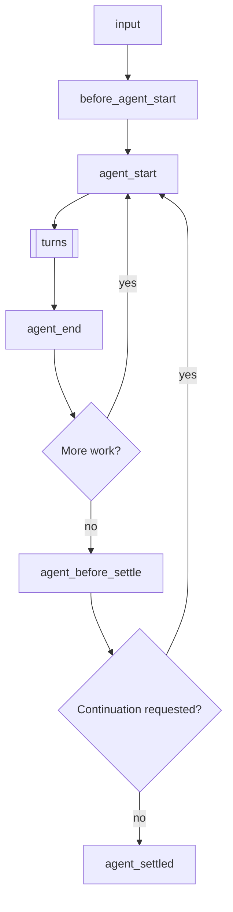
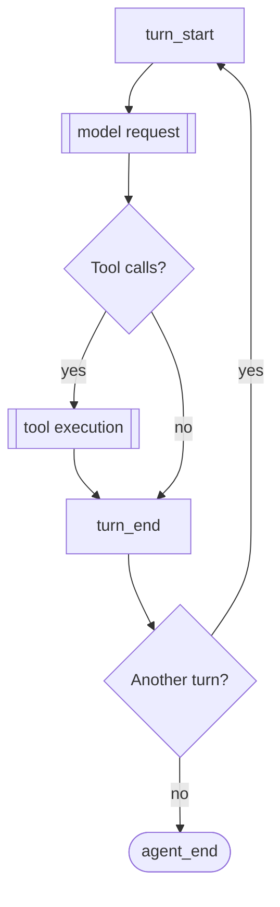
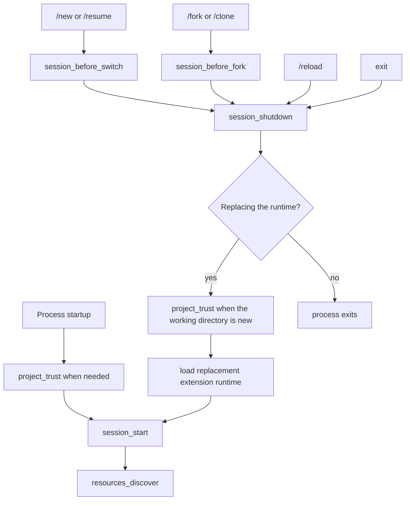

> Pi 可以创建扩展。告诉它你的使用场景，让它为你编写一个。

# 扩展 \{#extensions}

> **非官方简体中文译文。** 原文：[Pi v1.6.0 Extensions](https://github.com/earendil-works/pi/blob/v1.6.0/packages/coding-agent/docs/extensions.md)。[上游 MIT 许可证](./license.md)。

扩展是用来扩充 Pi 功能的 TypeScript 模块。扩展可以订阅生命周期事件、注册供大语言模型（LLM）调用的自定义工具、添加命令等。

扩展在 Pi 进程内运行，拥有与 Pi 相同的操作系统权限。它可以查看提示词、工具调用、文件、凭据和会话历史，因此只应加载来自可信来源的扩展。

> **可通过 /reload 重载的位置：** 将扩展放入 `~/.pi/agent/extensions/`（全局）或 `.pi/extensions/`（当前项目），Pi 会自动发现扩展。`pi -e ./path.ts` 仅用于快速测试。对于从上述位置自动发现的扩展，可以用 `/reload` 热重载。

**主要功能：**
- **自定义工具**：通过 `pi.registerTool()` 注册供 LLM 调用的工具
- **拦截事件**：阻止或修改工具调用、注入上下文、自定义上下文压缩
- **用户交互**：通过 `ctx.ui` 与用户交互（选择、确认、输入、通知）
- **自定义界面组件**：通过 `ctx.ui.custom()` 提供支持键盘输入的完整终端界面（TUI）组件，用于复杂交互
- **自定义命令**：通过 `pi.registerCommand()` 注册 `/mycommand` 等命令
- **会话持久化**：通过 `pi.appendEntry()` 保存重启后仍可使用的状态
- **自定义渲染**：控制工具调用、工具结果和消息在 TUI 中的显示方式
- **模型提供方和 MCP 服务器**：注册模型提供方、虚拟模型和 MCP 服务器

**用途示例：**
- 权限控制（执行 `rm -rf`、`sudo` 等命令前要求确认）
- Git 检查点（每轮用 stash 保存改动，在分支上恢复）
- 路径保护（禁止写入 `.env`、`node_modules/`）
- 自定义上下文压缩（按自己的方式总结对话）
- 对话摘要（见 `summarize.ts` 示例）
- 交互式工具（提问、向导、自定义对话框）
- 有状态的工具（待办事项列表、连接池）
- 外部集成（文件监听器、Webhook、CI 触发器）
- 等待时玩游戏（见 `snake.ts` 示例）

可运行的实现见 [examples/extensions/](https://github.com/earendil-works/pi/tree/v1.6.0/packages/coding-agent/examples/extensions/)。

## 目录 \{#table-of-contents}

- [快速上手](#quick-start)
- [扩展位置](#extension-locations)
- [可导入的包](#available-imports)
- [编写扩展](#writing-an-extension)
  - [扩展组织形式](#extension-styles)
- [事件](#events)
  - [生命周期概览](#lifecycle-overview)
  - [处理器的组合规则](#handler-composition)
  - [启动事件](#startup-events)
  - [资源事件](#resource-events)
  - [会话事件](#session-events)
  - [智能体事件](#agent-events)
  - [模型事件](#model-events)
  - [工具事件](#tool-events)
  - [用户 Bash 事件](#user-bash-events)
  - [输入事件](#input-events)
- [ExtensionContext](#extensioncontext)
- [ExtensionCommandContext](#extensioncommandcontext)
- [ExtensionAPI 方法](#extensionapi-methods)
- [状态管理](#state-management)
- [自定义工具](#custom-tools)
  - [工具公开范围](#tool-exposure)
  - [调用其他工具](#calling-other-tools)
  - [动态加载工具](#dynamic-tool-loading)
- [MCP 服务器](#mcp-servers)
- [自定义界面](#custom-ui)
- [错误处理](#error-handling)
- [各运行模式下的行为](#mode-behavior)
- [示例索引](#examples-reference)

<a id="create-an-extension"></a>

## 快速上手 \{#quick-start}

创建 `~/.pi/agent/extensions/my-extension.ts`：

```typescript
import { type ExtensionAPI, isToolCallEventType } from "@earendil-works/pi-coding-agent";
import { Type } from "typebox";

export default function (pi: ExtensionAPI) {
  // React to events
  pi.on("session_start", async (_event, ctx) => {
    ctx.ui.notify("Extension loaded!", "info");
  });

  pi.on("tool_call", async (event, ctx) => {
    if (isToolCallEventType("bash", event) && event.input.command.includes("rm -rf")) {
      const ok = await ctx.ui.confirm("Dangerous!", "Allow rm -rf?");
      if (!ok) return { block: true, reason: "Blocked by user" };
    }
  });

  // Register a custom tool
  pi.registerTool({
    name: "greet",
    label: "Greet",
    description: "Greet someone by name",
    parameters: Type.Object({
      name: Type.String({ description: "Name to greet" }),
    }),
    async execute(toolCallId, params, signal, onUpdate, ctx) {
      return {
        content: [{ type: "text", text: `Hello, ${params.name}!` }],
        details: {},
      };
    },
  });

  // Register a command
  pi.registerCommand("hello", {
    description: "Say hello",
    handler: async (args, ctx) => {
      ctx.ui.notify(`Hello ${args || "world"}!`, "info");
    },
  });
}
```

使用 `--extension`（或 `-e`）选项测试：

```bash
pi -e ./my-extension.ts
```

<a id="choose-where-it-loads"></a>

## 扩展位置 \{#extension-locations}

> **安全：** 扩展拥有你的全部系统权限，可以执行任意代码。只安装来自可信来源的扩展。

Pi 从受信任的位置自动发现扩展。只有信任项目后，Pi 才会加载项目内 `.pi/extensions` 中的扩展。

| 位置 | 作用范围 |
|----------|-------|
| `~/.pi/agent/extensions/*.ts` 或 `*.js` | 全局（所有项目） |
| `~/.pi/agent/extensions/*/index.ts` 或 `index.js` | 全局（子目录） |
| 包含 `pi.extensions` 字段的 `~/.pi/agent/extensions/*/package.json` | 全局（带清单的子目录） |
| `.pi/extensions/...` | 当前项目，目录结构同上 |

自动发现只深入一层子目录。较大的包在 `package.json` 清单中声明入口。

通过 `settings.json` 指定其他路径：

```json
{
  "packages": [
    "npm:@foo/bar@1.0.0",
    "git:github.com/user/repo@v1"
  ],
  "extensions": [
    "/path/to/local/extension.ts",
    "/path/to/local/extension/dir"
  ]
}
```

也可以在设置中用 `builtin:<name>` 条目指定内置扩展，详见[设置](./settings.md#resources)。要通过 npm 或 git 以 Pi 包的形式共享扩展，见 [Pi 包](./packages.md)。

## 可导入的包 \{#available-imports}

| 包 | 用途 |
|---------|---------|
| `@earendil-works/pi-coding-agent` | 扩展类型（`ExtensionAPI`、`ExtensionContext`、事件类型）和辅助函数 |
| `@earendil-works/pi-agent-core` | 智能体消息和工具的类型 |
| `typebox`、`typebox/compile`、`typebox/value` | 用于定义工具参数的模式 |
| `@earendil-works/pi-ai` | AI 实用工具（用于字符串枚举的 `StringEnum`、对话记录辅助函数、模型类型）。在 Pi 内部，它还导出 TypeBox 的 `Type`、`Static` 和 `TSchema`，但发布的包不再重新导出这三项。请在新代码中从 `typebox` 导入它们 |
| `@earendil-works/pi-ai/compat`、`/models`、`/oauth`、`/providers/all` | 构建模型提供方、内置 API 和 OAuth 辅助函数 |
| `@earendil-works/pi-tui` | 用于自定义渲染的终端界面组件 |

Pi 将这些导入映射到自身使用的模块，因此扩展与 Pi 共用相同的类和注册表。旧名称 `@mariozechner/*` 和 `@sinclair/typebox` 也映射到相同的模块。

扩展也支持 npm 依赖。在扩展旁边或上级目录中添加 `package.json`，运行 `npm install`，Pi 就会自动解析从 `node_modules/` 导入的模块。

对于通过 `pi install` 从 npm 或 git 安装的 Pi 包，必须在 `dependencies` 中声明运行时依赖。Pi 不会安装 `devDependencies`。不要在 `dependencies` 中列出上面这些由 Pi 提供的包。见[声明依赖](./packages.md#declare-dependencies)。

### 工具参数模式与 TypeBox \{#tool-parameter-schemas-and-typebox}

无论工具参数的模式由什么生成，Pi 都使用 `@earendil-works/pi-schema` 按 JSON Schema 验证参数。TypeBox 模式本身就是 JSON Schema，可以直接使用。验证前，Pi 会转换类型不严格匹配的参数：数字字符串转为数字，`"true"` 转为 `true`，单个值转为只有一项的数组，并移除值为 `null` 的可选属性。TypeBox 中超出 JSON Schema 的功能不适用于工具参数：

- Pi 不执行 `Type.Refine()` 定义的细化验证。请在 `execute()` 中检查这类约束。
- `Type.BigInt()`、`Type.Undefined()` 和 `Type.Void()` 会拒绝所有参数，因为 JSON 中没有这类值。编解码器（`Type.Codec()`）不执行解码：`execute()` 收到的是 JSON 值。
- Pi 不检查通过 TypeBox 的 `Format.Set()` 注册的格式。Pi 会检查标准格式，以及 `url` 和 `json-pointer-uri-fragment`。
- Pi 按属性名匹配属性，不使用正则表达式。`additionalProperties` 只适用于对象未声明的属性。
- 如果 `$ref` 没有指向有效目标，只有该位置上的参数会被拒绝。

模型看到的验证错误采用 pi-schema 的消息，例如 `- path: missing` 或 `- limit: expected number, got string`。

也可以使用 Node.js 内置模块（`node:fs`、`node:path` 等）。

## 编写扩展 \{#writing-an-extension}

扩展默认导出一个接收 `ExtensionAPI` 的工厂函数。该函数可以是同步或异步的：

```typescript
import type { ExtensionAPI } from "@earendil-works/pi-coding-agent";

export default function (pi: ExtensionAPI) {
  // Subscribe to events
  pi.on("event_name", async (event, ctx) => {
    // ctx.ui for user interaction
    const ok = await ctx.ui.confirm("Title", "Are you sure?");
    ctx.ui.notify("Done!", "info");
    ctx.ui.setStatus("my-ext", "Processing...");  // Footer status
    ctx.ui.setWidget("my-ext", ["Line 1", "Line 2"]);  // Widget above editor (default)
  });

  // Register tools, commands, shortcuts, flags
  pi.registerTool({ ... });
  pi.registerCommand("name", { ... });
  pi.registerShortcut("ctrl+x", { ... });
  pi.registerFlag("my-flag", { ... });
}
```

Pi 通过 [jiti](https://github.com/unjs/jiti) 加载扩展，因此 TypeScript 无需编译即可使用。

如果工厂函数返回 `Promise`，Pi 会等待它完成后再继续启动。也就是说，异步初始化会在 `session_start` 和 `resources_discover` 之前完成，也早于 Pi 处理通过 `pi.registerProvider()` 加入队列的模型提供方注册请求。

### 异步工厂函数 \{#async-factory-functions}

使用异步工厂函数处理启动时只需执行一次的工作，例如获取远程配置或动态发现可用模型。

```typescript
import type { ExtensionAPI } from "@earendil-works/pi-coding-agent";

export default async function (pi: ExtensionAPI) {
  const response = await fetch("http://localhost:1234/v1/models");
  const payload = (await response.json()) as {
    data: Array<{
      id: string;
      name?: string;
      context_window?: number;
      max_tokens?: number;
    }>;
  };

  pi.registerProvider("local-openai", {
    baseUrl: "http://localhost:1234/v1",
    apiKey: "$LOCAL_OPENAI_API_KEY",
    api: "openai-completions",
    models: payload.data.map((model) => ({
      id: model.id,
      name: model.name ?? model.id,
      reasoning: false,
      input: ["text"],
      cost: { input: 0, output: 0, cacheRead: 0, cacheWrite: 0 },
      contextWindow: model.context_window ?? 128000,
      maxTokens: model.max_tokens ?? 4096,
    })),
  });
}
```

这样，获取到的模型在正常启动时可用，也会出现在 `pi --list-models` 的结果中。如果模型列表会在 Pi 运行期间变化，请改为实现 `refreshModels`，见 [pi.registerProvider()](#piregisterprovidername-config)。

### 长期运行的资源与关闭 \{#long-lived-resources-and-shutdown}

即使某次调用不会启动会话，Pi 也可能运行扩展的工厂函数。不要在工厂函数中启动进程、套接字、文件监听器或计时器等后台资源。

请将后台资源的启动推迟到 `session_start`，或等到需要这些资源的命令、工具或事件触发时再启动。注册一个幂等的 `session_shutdown` 处理器，关闭你启动的所有会话级资源。

### 扩展组织形式 \{#extension-styles}

**单文件**：最简单的形式，适用于小型扩展：

```
~/.pi/agent/extensions/
└── my-extension.ts
```

**包含 index.ts 的目录**：适用于由多个文件组成的扩展：

```
~/.pi/agent/extensions/
└── my-extension/
    ├── index.ts        # Entry point (exports default function)
    ├── tools.ts        # Helper module
    └── utils.ts        # Helper module
```

**包含依赖的包**：适用于需要 npm 包的扩展：

```
~/.pi/agent/extensions/
└── my-extension/
    ├── package.json    # Declares dependencies and entry points
    ├── package-lock.json
    ├── node_modules/   # After npm install
    └── src/
        └── index.ts
```

```json
// package.json
{
  "name": "my-extension",
  "dependencies": {
    "zod": "^3.0.0",
    "chalk": "^5.0.0"
  },
  "pi": {
    "extensions": ["./src/index.ts"]
  }
}
```

在扩展目录中运行 `npm install`，此后就能直接从 `node_modules/` 导入模块。

<a id="extension-events"></a>

## 事件 \{#events}

<a id="understand-the-lifecycle"></a>

### 生命周期概览 \{#lifecycle-overview}

一条提示词会启动一次运行。Pi 先处理输入：

1. 对于扩展命令（`/name`），Pi 会调用对应的处理器，不触发 `input` 事件。Pi 总会检查手动输入或通过 RPC 传入的提示词是不是命令。`pi.sendUserMessage()` 只有在设置 `expandPromptTemplates: true` 时才会检查。
2. `input` 处理器可以拦截、转换或处理输入文本。
3. Pi 展开技能命令（`/skill:name`）和提示词模板（`/template`）。
4. Pi 触发 `before_agent_start`，然后开始智能体循环。

一次运行会推进多个轮次，随后检查是否有后续工作需要再次启动底层智能体运行：



后续工作包括重试、最后一次尝试的恢复处理、压缩重试或排队消息。因此，`agent_end` 并不表示运行已彻底结束并进入空闲状态。要判断这一状态，请使用 `agent_settled`。运行被中止时，Pi 会跳过 `agent_before_settle`，从 `agent_end` 直接进入 `agent_settled`。运行启动期间，包括检查是否需要压缩以及触发 `before_agent_start` 时，Pi 都处于忙碌状态，此时发送的消息会进入正在启动的运行。

每轮发送一次模型请求，并执行助手回复中的工具调用：



模型请求按以下顺序触发钩子：

1. `context`（可以修改对话消息）
2. `context_with_system`（可以修改完整的对话记录）
3. `before_provider_headers`（可以修改请求头）
4. `before_provider_request`（可以检查或替换请求载荷）
5. `after_provider_response`（在读取响应流之前提供状态和响应头）
6. `provider_stream_event`（解析后的原始流事件），以及助手消息的 `message_start` / `message_update` / `message_end`

实际执行的工具调用按以下顺序触发钩子：

1. `tool_execution_start`
2. `tool_call`（可以阻止调用或修改输入）
3. `tool_execution_update`（工具执行期间触发）
4. `tool_result`（可以修改结果）
5. `tool_execution_end`

未执行的调用会提前结束。工具未知或参数无效时，Pi 会跳过 `tool_call`；调用被阻止或中止时，Pi 会跳过工具执行和 `tool_result`。这些情况仍会触发 `tool_execution_end`，并携带错误结果。因此，要观察每个已结束的调用，请使用 `tool_execution_end`。

`turn_end` 可以追加条目，并请求继续运行。如果按正常流程还需要进行下一轮，且上下文已达到压缩阈值，Pi 会在下一轮开始前压缩上下文。用户消息、工具结果消息和自定义消息等其他消息也会触发消息事件。只有传输层公开相应阶段时，才会触发模型提供方的钩子。

会话启动和替换有独立的生命周期：



`session_start` 携带 `reason: "startup" | "reload" | "new" | "resume" | "fork"`，`session_shutdown` 携带 `reason: "quit" | "reload" | "new" | "resume" | "fork"`。重载后，`resources_discover` 使用 `reason: "reload"`，其他情况下使用 `"startup"`。退出包括 Ctrl+C、Ctrl+D、SIGHUP 和 SIGTERM。Pi 在加载受信任的项目资源之前触发 `project_trust`；如果替换会话时进入新的工作目录，Pi 可能再次触发此事件。

其他操作会改变当前会话，但不会替换会话运行时：

| 操作 | 事件 |
|---|---|
| `/compact` 或自动压缩 | `session_before_compact`（可以取消或自定义），随后触发 `session_compact` 或 `session_compact_failed` |
| `/tree` 导航 | `session_before_tree`（可以取消或自定义），随后触发 `session_tree` |
| `/name` 或 `pi.setSessionName()` | `session_info_changed` |
| `/model` 或循环切换模型（`Ctrl+P`） | `thinking_level_select`（仅在思考级别变化或被限制在允许范围内时触发），随后触发 `model_select` |
| 更改思考级别（通过设置、快捷键或 `pi.setThinkingLevel()`） | `thinking_level_select` |
| `!` 或 `!!` 命令 | `user_bash`（可以拦截） |
| 扩展的对话框或自定义界面等待用户操作 | `ui_prompt_start`、`ui_prompt_end` |
| 空闲时刷新提示词缓存 | `cache_warming_decision` |
| 扩展在启动后注册或移除 MCP 服务器 | `mcp_servers_change` |

<a id="events-and-concurrency"></a>
<a id="work-with-events"></a>

### 处理器的组合规则 \{#handler-composition}

处理器先按扩展加载顺序运行，同一扩展内按注册顺序运行。有些事件只发送通知，有些则可以转换数据、替换结果或取消操作：

| 模式 | 行为 |
|---|---|
| 通知 | Pi 忽略返回值。此类事件仅用于观察。 |
| 原地修改 | 后续处理器能看到对 `before_provider_headers.headers`、`before_agent_start.systemPromptOptions` 和 `tool_call.input` 等值的修改。 |
| 链式转换 | 后续处理器会收到前面的 `input`、`context`、`context_with_system`、`message_end`、`tool_result` 和 `before_provider_request` 处理器返回的值。 |
| 拦截 | 如果输入或 `user_bash` 命令已由处理器接管、工具调用被阻止，或会话操作被取消，该操作就不会进入常规的后备处理流程。 |
| 可影响后续流程的节点 | 每个 `turn_end` 或 `agent_before_settle` 处理器都能看到截至当前已提出的条目和是否继续运行的决定。 |
| 最后一项覆盖 | Pi 采用最后一个返回动作的 `cache_warming_decision` 处理器的结果。 |

通知处理器不应在处理流式事件时执行耗时操作。转换处理器应保留职责范围之外的字段；拦截处理器无法作出安全判断时，应默认阻止操作。

### 启动事件 \{#startup-events}

#### project_trust \{#project_trust}

Pi 在决定是否信任含有动态配置（`.pi` 或 `.agents/skills`）的项目之前触发此事件。Pi 会在启动时触发此事件；替换会话（例如 `/resume`）时，如果进入了当前进程尚未判定是否可信的工作目录，也会触发。只有用户级／全局扩展和通过命令行 `-e` 加载的扩展参与；项目内的扩展要等到信任判定完成后才会加载。

```typescript
pi.on("project_trust", async (event, ctx) => {
  // event.cwd - current working directory
  // ctx has a limited trust context: cwd, mode, hasUI, and select/confirm/input/notify UI helpers
  if (await ctx.ui.confirm("Trust project?", event.cwd)) {
    return { trusted: "yes", remember: true };
  }
  return { trusted: "undecided" };
});
```

`project_trust` 处理器必须返回 `{ trusted: "yes" | "no" | "undecided" }`。返回 `"yes"` 或 `"no"` 的用户级／全局扩展或命令行扩展负责作出判定；Pi 采用第一个明确的信任或拒绝判定，不再显示内置的信任提示。使用 `remember: true` 持久保存信任或拒绝判定，否则该判定只在当前进程中有效。返回 `"undecided"`，可交由后续处理器或内置信任流程判定。向用户显示提示前，请先检查 `ctx.hasUI`。如果没有处理器明确表示信任或拒绝，Pi 会继续常规的信任判定流程：先应用 `trust.json` 中已保存的决定，再由 `defaultProjectTrust` 控制默认是询问用户、信任还是拒绝。

### 资源事件 \{#resource-events}

#### resources_discover \{#resources_discover}

Pi 在 `session_start` 之后触发此事件，让扩展可以提供额外的技能、提示词和主题路径。
启动流程使用 `reason: "startup"`，重载使用 `reason: "reload"`。

```typescript
pi.on("resources_discover", async (event, _ctx) => {
  // event.cwd - current working directory
  // event.reason - "startup" | "reload"
  return {
    skillPaths: ["/path/to/skills"],
    promptPaths: ["/path/to/prompts"],
    themePaths: ["/path/to/themes"],
  };
});
```

#### mcp_servers_change \{#mcp_servers_change}

扩展绑定后，如果有扩展注册或注销 MCP 服务器，Pi 会触发此事件。`event.servers` 列出变更后所有已注册的服务器。处理此事件会将该扩展标记为负责连接已注册服务器的扩展，见 [MCP 服务器](#mcp-servers)。

### 会话事件 \{#session-events}

会话存储的内部机制和 SessionManager API 见[会话格式](./session-format.md)。

#### session_start \{#session_start}

Pi 在启动、加载或重载会话时触发此事件。

```typescript
pi.on("session_start", async (event, ctx) => {
  // event.reason - "startup" | "reload" | "new" | "resume" | "fork"
  // event.previousSessionFile - present for "new", "resume", and "fork"
  ctx.ui.notify(`Session: ${ctx.sessionManager.getSessionFile() ?? "ephemeral"}`, "info");
});
```

#### session_info_changed \{#session_info_changed}

通过 `/name`、RPC 或 `pi.setSessionName()` 设置当前会话的显示名称时，Pi 会触发此事件。

```typescript
pi.on("session_info_changed", async (event, ctx) => {
  // event.name - current normalized name, or undefined if cleared
  ctx.ui.notify(`Session renamed: ${event.name ?? "(none)"}`, "info");
});
```

#### session_before_switch \{#session_before_switch}

Pi 在开始新会话（`/new`）或切换会话（`/resume`）之前触发此事件。

```typescript
pi.on("session_before_switch", async (event, ctx) => {
  // event.reason - "new" or "resume"
  // event.targetSessionFile - session we're switching to (only for "resume")

  if (event.reason === "new") {
    const ok = await ctx.ui.confirm("Clear?", "Delete all messages?");
    if (!ok) return { cancel: true };
  }
});
```

成功切换会话或创建新会话后，Pi 先为旧扩展实例触发 `session_shutdown`，再为新会话重载并重新绑定扩展，最后触发 `session_start`，并传入 `reason: "new" | "resume"` 和 `previousSessionFile`。
请在 `session_shutdown` 中执行清理，然后在 `session_start` 中重新建立内存中的状态。

#### session_before_fork \{#session_before_fork}

通过 `/fork` 创建分支或通过 `/clone` 克隆会话时，Pi 会触发此事件。

```typescript
pi.on("session_before_fork", async (event, ctx) => {
  // event.entryId - ID of the selected entry
  // event.position - "before" for /fork, "at" for /clone
  return { cancel: true }; // Cancel fork/clone
  // OR
  return { skipConversationRestore: true }; // Reserved for future conversation restore control
});
```

成功创建分支或克隆会话后，Pi 先为旧扩展实例触发 `session_shutdown`，再为新会话重载并重新绑定扩展，最后触发 `session_start`，并传入 `reason: "fork"` 和 `previousSessionFile`。
请在 `session_shutdown` 中执行清理，然后在 `session_start` 中重新建立内存中的状态。

<a id="session_before_compact--session_compact"></a>

#### session_before_compact / session_compact / session_compact_failed \{#session_before_compact--session_compact--session_compact_failed}

Pi 在压缩上下文时触发这些事件。详情见[上下文压缩](./compaction.md)。

```typescript
pi.on("session_before_compact", async (event, ctx) => {
  const { preparation, branchEntries, customInstructions, reason, willRetry, signal } = event;

  // reason - "manual" (/compact), "threshold", or "overflow"
  // willRetry - whether the aborted turn is retried after compaction (overflow recovery)

  // Cancel:
  return { cancel: true };

  // Custom summary:
  return {
    compaction: {
      summary: "...",
      firstKeptEntryId: preparation.firstKeptEntryId,
      tokensBefore: preparation.tokensBefore,
      // usage: summaryResponse.usage, // Optional; included in session totals
    }
  };
});

pi.on("session_compact", async (event, ctx) => {
  // event.compactionEntry - the saved compaction
  // event.fromExtension - whether extension provided it
  // event.reason - "manual" (/compact), "threshold", or "overflow"
  // event.willRetry - whether the aborted turn is retried after compaction (overflow recovery)
});

pi.on("session_compact_failed", async (event, ctx) => {
  // event.reason - "manual" (/compact), "threshold", or "overflow"
  // event.errorMessage - present for non-abort failures
  // event.aborted - true for cancelled/aborted compactions
  // event.willRetry - whether the aborted turn would have retried after compaction
  // event.fromExtension - whether extension-provided compaction content was being used
});
```

#### session_before_tree / session_tree \{#session_before_tree--session_tree}

Pi 在通过 `/tree` 导航时触发这些事件。有关会话树的导航概念，见[会话与上下文](./sessions.md)。

```typescript
pi.on("session_before_tree", async (event, ctx) => {
  const { preparation, signal } = event;
  // preparation.targetId, oldLeafId, commonAncestorId, entriesToSummarize,
  // userWantsSummary, customInstructions, replaceInstructions, label
  return { cancel: true };
  // OR provide custom summary (used only when preparation.userWantsSummary is true):
  return {
    summary: {
      summary: "...",
      // usage: summaryResponse.usage, // Optional; included in session totals
      details: {},
    },
  };
  // OR override summarization options: customInstructions, replaceInstructions, label
});

pi.on("session_tree", async (event, ctx) => {
  // event.newLeafId, oldLeafId, summaryEntry, fromExtension
});
```

#### session_shutdown \{#session_shutdown}

Pi 在销毁已启动的会话运行时之前触发此事件。请用此事件清理在 `session_start` 或其他会话级钩子中打开的资源。

```typescript
pi.on("session_shutdown", async (event, ctx) => {
  // event.reason - "quit" | "reload" | "new" | "resume" | "fork"
  // event.targetSessionFile - destination session for session replacement flows
  // Cleanup, save state, etc.
});
```

### 智能体事件 \{#agent-events}

#### before_agent_start \{#before_agent_start}

Pi 在处理并展开输入后、开始运行前触发此事件。处理器可以注入消息、修改系统提示词，或同时执行这两项操作。

`event.messageType` 表示本次运行的启动来源。由提示词或 `pi.sendUserMessage()` 启动时，其值为 `"user"`，事件包含 `prompt` 和 `images`。在空闲时调用 `pi.sendMessage(..., { triggerTurn: true })` 启动运行，其值为 `"custom"`，事件包含用于启动运行的 `message`，不含 `prompt`。

```typescript
pi.on("before_agent_start", async (event, ctx) => {
  // event.messageType - "user" | "custom"
  // event.prompt, event.images - user's prompt text and images (messageType "user")
  // event.message - the custom message that starts the run (messageType "custom")
  // event.systemPrompt - current chained system prompt for this handler
  //   (includes changes from earlier before_agent_start handlers)
  // event.systemPromptOptions - structured options used to build the system prompt
  //   .customPrompt - exact prompt prefix from --system-prompt, SYSTEM.md, or custom templates
  //   .forceSystemPrompt - optional exact replacement for the complete prompt
  //   .selectedTools - tools currently active in the prompt
  //   .hiddenTools - selected tools whose declarations requests leave out
  //   .toolSnippets - one-line descriptions for each tool
  //   .toolGuidelines - rule bullets keyed by tool name
  //   .promptGuidelines - additional custom rule bullets
  //   .sections - custom XML-wrapped sections keyed by tag name
  //   .appendSystemPrompt - text from --append-system-prompt flags
  //   .cwd - working directory
  //   .contextFiles - AGENTS.md files and other loaded context files
  //   .skills - loaded skills

  return {
    // Inject a persistent message (stored in session, sent to LLM)
    message: {
      customType: "my-extension",
      content: "Additional context for the LLM",
      display: true,
    },
    // Replace the system prompt for this turn (chained across extensions)
    systemPrompt: event.systemPrompt + "\n\nExtra instructions for this turn...",
  };
});
```

无论运行以哪种方式启动，Pi 都会将返回的 `message` 加入本次运行。要跳过由自定义消息启动的运行，请检查 `messageType`。

通过 `systemPromptOptions` 字段，扩展可以访问 Pi 构建系统提示词时使用的同一份结构化数据。你可以修改其中的集合。优先修改 `sections`、`selectedTools` 或 `promptGuidelines`。Pi 会将修改后的提示词各部分与模型已有的内容比较，再追加一条系统消息，仅更新变化的部分。返回 `systemPrompt` 或设置 `forceSystemPrompt` 会替换本次运行的整个系统提示词。每个模型提供方都会收到强制指定的文本作为开头的系统提示词（文本变化时缓存未命中），而会话记录仍会保存提示词的结构化各部分。更改选用的工具后，工具提供的提示词内容和向模型提供方开放的可执行工具都会随之更新。在处理器内调用 `pi.setActiveTools()` 与编辑 `selectedTools` 的效果相同。支持在对话中途接收系统消息的模型会就地接收更新，并保留已缓存的前缀；其他模型会收到重放后的提示词作为系统提示词，每次变更都会造成一次缓存未命中。

在 `before_agent_start` 中，`event.systemPrompt` 和 `ctx.getSystemPrompt()` 都反映处理器链运行到当前处理器时的系统提示词。后续的 `before_agent_start` 处理器仍可继续修改它。

<a id="agent_start--agent_end--agent_settled"></a>

#### agent_start / agent_end / agent_before_settle / agent_settled \{#agent_start--agent_end--agent_before_settle--agent_settled}

底层智能体开始运行时触发 `agent_start`。该次运行结束时触发 `agent_end`，但 Pi 此时仍可能自动重试、自动压缩上下文后重试，或继续处理排队的后续消息。`agent_before_settle` 是最后一个可采取操作的边界事件：处理器可以追加会话条目，并请求继续一次。`agent_settled` 是最终事件，仅用于通知。如果状态集成需要确认 Pi 不会再自动继续运行，请使用该事件。

```typescript
pi.on("agent_start", async (_event, ctx) => {});

pi.on("agent_end", async (event, ctx) => {
  // event.messages - messages from this low-level run
});

let addedReviewReminder = false;
pi.on("agent_before_settle", async (event, ctx) => {
  if (addedReviewReminder) return;
  addedReviewReminder = true;
  return {
    entries: [...event.entries, {
      type: "custom_message",
      customType: "review-reminder",
      content: "Review the final diff before replying.",
      display: false,
    }],
    continue: true,
  };
});

pi.on("agent_settled", async (event, ctx) => {
  // event.aborted - true when the run ended because it was aborted, for example with Escape
  // ctx.isIdle() is true; runs requested here start after all settled handlers finish.
});
```

如果本次运行在 `agent_before_settle` 处理器执行期间中止，Pi 仍会写入处理器返回的有效条目，但不会执行其继续请求。在 `agent_settled` 中请求的工作会推迟到所有该事件的处理器执行完毕之后，因此通知分发不会重入。

#### ui_prompt_start / ui_prompt_end \{#ui_prompt_start--ui_prompt_end}

扩展界面向用户显示阻塞式提示时，会触发这两个仅用于通知的生命周期事件。`ctx.ui.select()`、`ctx.ui.confirm()`、`ctx.ui.input()`、`ctx.ui.editor()` 和 `ctx.ui.custom()` 开始和结束时会触发相应事件，方便宿主或状态集成显示“等待用户”，而不只是“运行中”。

嵌套或重叠的提示会合并为一个最外层等待区间。Pi 尽力调用处理器，在显示或关闭提示时不会等待处理器执行完毕。

```typescript
pi.on("ui_prompt_start", async (event, ctx) => {
  // event.reason === "ui_prompt"
  // event.kind: "select" | "confirm" | "input" | "editor" | "custom"
  // event.title: prompt title when available
});

pi.on("ui_prompt_end", async (event, ctx) => {
  // Pi is no longer waiting on that UI prompt span.
});
```

#### turn_start / turn_end \{#turn_start--turn_end}

每个轮次都会触发这两个事件。一个轮次包含一次 LLM 回复及其工具调用。

```typescript
pi.on("turn_start", async (event, ctx) => {
  // event.turnIndex, event.timestamp
});

let replacedResponse = false;
pi.on("turn_end", async (event, ctx) => {
  // event.turnIndex, event.message, event.toolResults
  // event.entries contains the structural entries proposed so far.
  if (replacedResponse || event.outcome !== "completed" || event.toolResults.length > 0) return;
  replacedResponse = true;
  return {
    entries: [
      ...event.entries,
      { type: "context_edit", targetId: event.messageEntryId, replacement: null },
      {
        type: "custom_message",
        customType: "replacement-instruction",
        content: "Answer again using the persisted user request.",
        display: false,
      },
    ],
    continue: true,
  };
});
```

`turn_end` 在助手消息和工具结果消息持久化之后、底层 `turn_end` 事件之前触发。重试退避和最后一次尝试的恢复处理仍在 `agent_end` 之后进行，保持原有的生命周期顺序和队列顺序。这些工作完成后，`agent_before_settle` 看到的是修复后的会话投影。边界事件处理器按扩展加载顺序和处理器注册顺序运行。每个处理器都可以在 `event.entries` 中看到此前提出的条目，并在 `event.context` 中看到根据这些条目重新构建的上下文。返回 `entries` 或 `continue` 只替换相应字段，省略的字段保持当前提案中的值。允许的草稿条目类型为 `custom`、`custom_message`、`context_edit` 和 `compaction`。所有处理器完成后，Pi 先验证完整提案，再按列表顺序追加条目。Pi 会报告处理器错误，但后续处理器仍会运行。验证可以避免语义错误导致条目只应用了一部分，但持久化不是事务性的。

`continue: true` 确保本次边界事件分发后再向模型提供方发出一次请求。如果工具结果、引导消息或后续消息已经触发了该请求，就不会再额外发送请求；否则 Pi 会发送一次仅包含上下文的请求。出错或被中止的回复仍会立即结束运行。`continue: false` 不会阻止正常流程中的工作。请为继续请求设置条件：无条件返回 `continue: true` 会在下一次响应后再次求值，可能导致无限循环。`custom_message` 草稿由扩展编写，会为模型添加一条用户角色消息，但不会触发人工输入钩子、斜杠命令、技能或提示词模板。

构造 `TurnEndEvent` 值的宿主集成必须提供 `messageEntryId`、`toolResultEntryIds`、`outcome`、`entries`、`continue` 和 `context`。对 `ExtensionEvent` 使用穷举式 switch 语句时，也必须处理 `agent_before_settle`。`ExtensionRunner.emit()` 不处理可采取操作的轮次边界。请通过 `emitBoundary(baseEvent, buildContext)` 分发 `turn_end` 和 `agent_before_settle`，让每个处理器都能预览此前处理器修改后的上下文。运行器的其他专用方法仍会为 `session_before_*` 等事件返回结果。

#### message_start / message_update / message_end \{#message_start--message_update--message_end}

消息生命周期发生变化时触发。

- 每条消息都会触发 `message_start` 和 `message_end`，包括用户消息、助手消息、工具结果消息和自定义消息。
- 助手消息有流式更新时触发 `message_update`。
- `message_end` 处理器可以返回 `{ message }` 来替换最终确定的消息。替换后的消息必须保留相同的 `role`。

```typescript
pi.on("message_start", async (event, ctx) => {
  // event.message
});

pi.on("message_update", async (event, ctx) => {
  // event.message
  // event.assistantMessageEvent (token-by-token stream event)
});

pi.on("message_end", async (event, ctx) => {
  if (event.message.role !== "assistant") return;

  return {
    message: {
      ...event.message,
      usage: {
        ...event.message.usage,
        cost: {
          ...event.message.usage.cost,
          total: 0.123,
        },
      },
    },
  };
});
```

#### tool_execution_start / tool_execution_update / tool_execution_end \{#tool_execution_start--tool_execution_update--tool_execution_end}

工具执行的生命周期发生变化时触发。

在并行工具模式下：
- 预检时，Pi 按助手消息中工具调用的原始顺序发出 `tool_execution_start`
- 不同工具的 `tool_execution_update` 事件可能交错发出
- 每个工具的结果确定后，Pi 按工具完成顺序发出 `tool_execution_end`
- 最终的 `toolResult` 消息事件仍在之后按助手消息中工具调用的原始顺序发出

```typescript
pi.on("tool_execution_start", async (event, ctx) => {
  // event.toolCallId, event.toolName, event.args
});

pi.on("tool_execution_update", async (event, ctx) => {
  // event.toolCallId, event.toolName, event.args, event.partialResult
});

pi.on("tool_execution_end", async (event, ctx) => {
  // event.toolCallId, event.toolName, event.result, event.isError
  // event.durationMs - milliseconds execute() took; absent when the tool did not run
});
```

当工具调用由另一个工具发起时，这三个事件以及 `tool_call` 和 `tool_result` 都会携带 `parentToolCallId`。参阅[调用其他工具](#calling-other-tools)。

#### context \{#context}

每次调用 LLM 前触发。可在不破坏原始消息的情况下修改消息。消息类型见[会话格式](./session-format.md)。

```typescript
pi.on("context", async (event, ctx) => {
  // event.messages - deep copy without system messages, safe to modify
  const filtered = event.messages.filter(m => !shouldPrune(m));
  return { messages: filtered };
});
```

`event.messages` 包含对话内容，不含系统消息。提示词和工具声明由 Pi 管理，不属于此钩子。处理器返回修改后的列表时，Pi 会将当前提示词的各个部分和工具声明重新放入一条系统消息，并将其置于返回的消息之前。因此，无论是筛选消息、截取窗口，还是从上下文压缩摘要处截取消息，都不会丢失提示词或工具。如果列表未改动，Pi 会保留对话中间的系统消息及其位置，让接受这类消息的模型继续使用已缓存的前缀。处理器添加的系统消息会保留在 Pi 放在开头的系统消息之后。若要持久更改提示词或工具集，请使用 [`before_agent_start`](#before_agent_start) 或 `pi.setActiveTools()`；若只想编辑某一次请求的系统消息，请使用 [`context_with_system`](#context_with_system)。

#### context_with_system \{#context_with_system}

每次调用 LLM 前，在所有 `context` 处理器运行完毕且 Pi 已恢复提示词和工具状态后触发。`event.messages` 包含完整的对话记录，包括开头的系统消息，以及对话中间对提示词或工具的更新（参阅[会话格式](./session-format.md#sessionmessageentry)）。Pi 会原样发送返回的消息，因此此钩子决定该次请求的提示词和工具声明。

```typescript
import { getCurrentSystemMessage } from "@earendil-works/pi-ai";

pi.on("context_with_system", async (event, ctx) => {
  const cut = findCutIndex(event.messages);
  // Fold the dropped prefix so its prompt and tool state survives as the new head.
  const head = getCurrentSystemMessage(event.messages.slice(0, cut));
  return { messages: head ? [head, ...event.messages.slice(cut)] : event.messages.slice(cut) };
});
```

索引 0 处必须保留一条系统消息。模型提供方会从该消息中读取提示词和初始工具声明；如果处理器移除了该位置的系统消息，Pi 会报错。删除一条系统消息也会删除其中携带的工具声明和提示词各部分的更新。可使用 `@earendil-works/pi-ai` 中的 `getCurrentSystemPrompt()` 和 `getCurrentTools()` 检查输出。处理器按扩展加载顺序运行；如果 `before_agent_start` 强制指定了 `systemPrompt`，Pi 之后仍会将其应用到请求中。

#### before_provider_headers \{#before_provider_headers}

出站 HTTP 请求头组装完成后触发。此钩子可以添加、覆盖或移除请求头。

处理器直接修改 `event.headers`。将对应键设为字符串可以添加或覆盖请求头，设为 `null` 则将其删除。

```typescript
pi.on("before_provider_headers", (event, ctx) => {
  // Add or override — e.g. a session id for gateway tracing/attribution
  event.headers["x-session-id"] = ctx.sessionManager.getSessionId();

  // Drop a tracking header pi adds for this call
  event.headers["X-OpenRouter-Title"] = null;
});
```

每个发往模型提供方的请求只触发一次此钩子；重试会复用相同的请求头，不会再次触发钩子。

#### before_provider_request \{#before_provider_request}

在构造好特定于模型提供方的请求载荷之后、即将发送请求时触发。处理器按扩展加载顺序运行。返回 `undefined` 会保留原载荷。返回其他任意值都会替换载荷，后续处理器和实际请求都将使用替换后的值。

此钩子可以改写模型提供方层面的系统指令，也可以将其完全移除。`ctx.getSystemPrompt()` 不会反映这些载荷层面的更改，因为它返回的是 Pi 的系统提示词字符串，而不是发往模型提供方的最终序列化载荷。

```typescript
pi.on("before_provider_request", (event, ctx) => {
  console.log(JSON.stringify(event.payload, null, 2));

  // Optional: replace payload
  // return { ...event.payload, temperature: 0 };
});
```

此钩子主要用于调试模型提供方的序列化和缓存行为。

载荷包含完整请求。支持从上一条响应继续的模型提供方（如通过 WebSocket 使用的 OpenAI Codex、Anthropic 消息线程）可能只发送自上次请求以来新增的部分。

#### after_provider_response \{#after_provider_response}

接收到 HTTP 响应之后、读取流式响应体之前触发。处理器按扩展加载顺序运行。

```typescript
pi.on("after_provider_response", (event, ctx) => {
  // event.status - HTTP status code
  // event.headers - normalized response headers
  if (event.status === 429) {
    console.log("rate limited", event.headers["retry-after"]);
  }
});
```

是否可读取响应头取决于模型提供方和传输方式。对 HTTP 响应进行抽象封装的模型提供方可能不提供响应头。

#### provider_stream_event \{#provider_stream_event}

模型提供方的每条流式事件在解析后、Pi 对其进行规范化之前触发。此事件仅用于通知，不会持久化。

```typescript
pi.on("provider_stream_event", (event, ctx) => {
  // event.provider, event.api, event.model
  // event.data - earliest structured value available to Pi (read-only)
});
```

`event.data` 不一定是原始 HTTP 字节或 SSE 帧。请将其视为只读数据，因为修改可能影响规范化结果。Pi 按流中事件的顺序等待处理器执行完毕，因此执行缓慢的处理器会延迟读取流。Pi 会报告处理器错误，但不会更改模型提供方的响应。参阅 [`debug-provider.ts`](https://github.com/earendil-works/pi/blob/v1.6.0/packages/coding-agent/examples/extensions/debug-provider.ts)，其中提供了可按需启用的查看器，按助手消息对原始事件分组。

#### cache_warming_decision \{#cache_warming_decision}

每次刷新提示词缓存前触发，此时事件中已填入 Pi 的决定。事件只携带 Pi 的成本估算；其他信息请通过 `ctx.model`、`ctx.isIdle()` 和 `ctx.getContextUsage()` 获取。

```typescript
pi.on("cache_warming_decision", (event, ctx) => {
  // event.warmCost: price of this refresh
  // event.missCost: extra price of the next request if the entry is lost
  // event.continuationProbability: pi's estimate that a request arrives in time
  // event.action: "warm" | "stop", pi's decision

  if (ctx.model?.provider === "my-provider") {
    return { action: "stop" };
  }
});
```

返回 `{ action: "warm" }` 或 `{ action: "stop" }` 可以覆盖 Pi 的决定。以最后一个返回操作的处理器为准。`"stop"` 会停止预热，直至下一次实际请求。

### 模型事件 \{#model-events}

#### model_select \{#model_select}

通过 `/model` 命令、循环切换模型（`Ctrl+P`）或调用 `pi.setModel()` 更换模型时触发。恢复会话时不会触发；若要初始化依赖模型的状态，请在 `session_start` 中读取 `ctx.model`。

```typescript
pi.on("model_select", async (event, ctx) => {
  // event.model - newly selected model
  // event.previousModel - previous model (undefined if first selection)
  // event.source - "set" | "cycle"

  const prev = event.previousModel
    ? `${event.previousModel.provider}/${event.previousModel.id}`
    : "none";
  const next = `${event.model.provider}/${event.model.id}`;

  ctx.ui.notify(`Model changed (${event.source}): ${prev} -> ${next}`, "info");
});
```

可以在当前模型更换时使用此事件更新界面元素（如状态栏、页脚），或执行特定于模型的初始化。

#### thinking_level_select \{#thinking_level_select}

思考级别变更时触发。此事件仅用于通知，处理器的返回值会被忽略。

```typescript
pi.on("thinking_level_select", async (event, ctx) => {
  // event.level - newly selected thinking level
  // event.previousLevel - previous thinking level

  ctx.ui.setStatus("thinking", `thinking: ${event.level}`);
});
```

调用 `pi.setThinkingLevel()`、更换模型或操作内置的思考级别控件导致当前思考级别变更时，可以使用此事件更新扩展界面。

<a id="tool-call-events"></a>

### 工具事件 \{#tool-events}

#### tool_call \{#tool_call}

在 `tool_execution_start` 之后、工具执行之前触发。**可以阻止工具调用。** 使用 `isToolCallEventType` 缩小类型范围，获取有明确类型的输入。

在运行 `tool_call` 处理器之前，Pi 会等待 `AgentSession` 处理完此前已发出的 Agent 事件。因此，`ctx.sessionManager` 已同步到当前发起工具调用的助手消息。

在默认的并行工具执行模式下，Pi 会逐一预检同一条助手消息中的并列工具调用，再并行执行这些调用。`tool_call` 处理器无法保证通过 `ctx.sessionManager` 看到同一条助手消息中其他并列工具调用的结果。

`event.input` 可修改。若要在工具执行前调整参数，请直接修改该对象。

行为保证：
- 对 `event.input` 的修改会影响工具的实际执行
- 后续 `tool_call` 处理器可以看到前面的处理器所做的修改
- 修改后，Pi 不会重新验证输入
- `tool_call` 通过返回 `{ block: true, reason?: string, terminate?: boolean }` 控制是否阻止调用
- `terminate` 只对被阻止的调用生效；仅当本批次中所有最终结果都要求终止时，智能体才会提前停止

```typescript
import { isToolCallEventType } from "@earendil-works/pi-coding-agent";

pi.on("tool_call", async (event, ctx) => {
  // event.toolName - "bash", "read", "write", "edit", etc.
  // event.toolCallId
  // event.input - tool parameters (mutable)

  // Built-in tools: no type params needed
  if (isToolCallEventType("bash", event)) {
    // event.input is { command: string; timeout?: number }
    event.input.command = `source ~/.profile\n${event.input.command}`;

    if (event.input.command.includes("rm -rf")) {
      return { block: true, reason: "Dangerous command", terminate: true };
    }
  }

  if (isToolCallEventType("read", event)) {
    // event.input is { path: string; offset?: number; limit?: number }
    console.log(`Reading: ${event.input.path}`);
  }
});
```

#### 为自定义工具输入指定类型 \{#typing-custom-tool-input}

自定义工具应导出其输入类型：

```typescript
// my-tool.ts
import { type Static, Type } from "typebox";

export const myToolSchema = Type.Object({ action: Type.String() });
export type MyToolInput = Static<typeof myToolSchema>;
```

使用 `isToolCallEventType` 时，显式指定类型参数：

```typescript
import { isToolCallEventType } from "@earendil-works/pi-coding-agent";
import type { MyToolInput } from "./my-tool.ts";

pi.on("tool_call", (event) => {
  if (isToolCallEventType<"my_tool", MyToolInput>("my_tool", event)) {
    event.input.action;  // typed
  }
});
```

#### tool_result \{#tool_result}

工具执行完毕后，在发出 `tool_execution_end` 和最终工具结果消息事件之前触发。**可以修改结果。**

在并行工具模式下，`tool_result` 和 `tool_execution_end` 可能按工具完成顺序交错发出。最终的 `toolResult` 消息事件仍在之后按助手消息中工具调用的原始顺序发出。

`tool_result` 处理器像中间件一样依次处理结果：
- 处理器按扩展加载顺序运行
- 每个处理器都可以看到经之前的处理器修改后的最新结果
- 处理器可以只返回需要修改的字段（`content`、`details`、`structuredContent`、`isError` 或 `usage`）；省略的字段保留当前值
- 替换 `content` 时如果没有返回 `structuredContent`，Pi 会丢弃原有的结构化内容，因为它可能与替换后的内容不再匹配

请在处理器内部启动嵌套的异步操作时使用 `ctx.signal`。这样按 Esc 就能取消扩展启动的模型调用、`fetch()` 等支持中止的操作。

```typescript
import { isBashToolResult } from "@earendil-works/pi-coding-agent";

pi.on("tool_result", async (event, ctx) => {
  // event.toolName, event.toolCallId, event.input, event.parentToolCallId
  // event.content, event.details, event.structuredContent, event.isError, event.usage

  if (isBashToolResult(event)) {
    // event.details is typed as BashToolDetails
  }

  const response = await fetch("https://example.com/summarize", {
    method: "POST",
    body: JSON.stringify({ content: event.content }),
    signal: ctx.signal,
  });

  // Modify result:
  return { content: [...], details: {...}, isError: false, usage: nestedModelUsage };
});
```

### 用户 Bash 事件 \{#user-bash-events}

#### user_bash \{#user_bash}

用户执行 `!` 或 `!!` 命令时触发。**可以拦截。**

```typescript
import { createLocalBashOperations } from "@earendil-works/pi-coding-agent";

pi.on("user_bash", (event, ctx) => {
  // event.command - the bash command
  // event.excludeFromContext - true if !! prefix
  // event.cwd - working directory

  // Option 1: Provide custom operations (e.g., SSH)
  return { operations: remoteBashOps };

  // Option 2: Wrap pi's built-in local bash backend
  const local = createLocalBashOperations();
  return {
    operations: {
      exec(command, cwd, options) {
        return local.exec(`source ~/.profile\n${command}`, cwd, options);
      }
    }
  };

  // Option 3: Full replacement - return result directly
  return { result: { output: "...", exitCode: 0, cancelled: false, truncated: false } };
});
```

返回 `undefined` 会将事件传给下一个处理器。如果没有处理器处理该事件，Pi 会在本地执行命令。返回有效结果会停止事件传播：`operations` 通过提供的后端执行命令，`result` 仅记录已完成的命令，不执行它。

### 输入事件 \{#input-events}

#### input \{#input}

收到用户输入后，在检查扩展命令之后、展开技能和模板之前触发。此事件接收原始输入文本，因此此时尚未展开 `/skill:foo` 和 `/template`。

**处理顺序：**
1. Pi 先检查扩展命令（`/cmd`）。如果找到匹配的命令，Pi 会运行其处理器并跳过输入事件。对于来自 `pi.sendUserMessage()` 的消息，只有设置了 `expandPromptTemplates: true` 才会检查扩展命令。
2. 触发 `input` 事件，可以拦截、转换或处理输入。
3. 如果输入尚未处理，Pi 将技能命令（`/skill:name`）展开为技能内容。
4. 如果输入尚未处理，Pi 将提示词模板（`/template`）展开为模板内容。
5. 智能体开始处理输入（`before_agent_start` 等）。

```typescript
pi.on("input", async (event, ctx) => {
  // event.text - raw input (before skill/template expansion)
  // event.images - attached images, if any
  // event.source - "interactive" (typed), "rpc" (API), or "extension" (via sendUserMessage)
  // event.streamingBehavior - "steer" | "followUp" | undefined
  //   undefined when idle, "steer" for mid-stream interrupts,
  //   "followUp" for messages queued until the agent finishes

  // Transform: rewrite input before expansion
  if (event.text.startsWith("?quick "))
    return { action: "transform", text: `Respond briefly: ${event.text.slice(7)}` };

  // Handle: respond without LLM (extension shows its own feedback)
  if (event.text === "ping") {
    ctx.ui.notify("pong", "info");
    return { action: "handled" };
  }

  // Route by source: skip processing for extension-injected messages
  if (event.source === "extension") return { action: "continue" };

  // Intercept skill commands before expansion
  if (event.text.startsWith("/skill:")) {
    // Could transform, block, or let pass through
  }

  return { action: "continue" };  // Default: pass through to expansion
});
```

**返回结果：**
- `continue`：原样传递输入；处理器未返回值时采用此行为。
- `transform`：修改文本、图片或两者，然后继续执行展开步骤。
- `handled`：完全跳过智能体处理；以第一个返回此结果的处理器为准。

转换会在处理器之间依次传递。根据 `streamingBehavior` 进行路由的示例见 [input-transform.ts](https://github.com/earendil-works/pi/blob/v1.6.0/packages/coding-agent/examples/extensions/input-transform.ts) 和 [input-transform-streaming.ts](https://github.com/earendil-works/pi/blob/v1.6.0/packages/coding-agent/examples/extensions/input-transform-streaming.ts)。

<a id="use-extension-context"></a>

## ExtensionContext \{#extensioncontext}

所有处理器都接收 `ctx: ExtensionContext`。工具的 `execute()` 接收 `ExtensionToolContext`，它额外提供 `ctx.tools` 和 `ctx.executeTool()`（参阅[调用其他工具](#calling-other-tools)）。命令处理器接收 [`ExtensionCommandContext`](#extensioncommandcontext)。

### ctx.ui \{#ctxui}

提供与用户交互的界面方法。详情见[自定义界面](#custom-ui)。

### ctx.mode \{#ctxmode}

当前运行模式：`"tui"`、`"rpc"`、`"json"` 或 `"print"`。请用 `ctx.mode === "tui"` 检查当前是否为终端界面模式，仅在此模式下使用 `custom()`、组件工厂、终端输入、直接渲染 TUI 等功能。

### ctx.hasUI \{#ctxhasui}

在 TUI 和 RPC 模式下为 `true`，在输出模式（`-p`）和 JSON 模式下为 `false`。调用在 TUI 和 RPC 模式下都可用的对话框方法（`select`、`confirm`、`input`、`editor`）和无需等待结果的方法（`notify`、`setStatus`、`setWidget`、`setTitle`、`setEditorText`）前，可以用此属性检查是否有可用界面。在 RPC 模式下，一些 TUI 专用方法不执行任何操作，或只返回默认值（参阅 [RPC 扩展界面](./rpc-extension-ui.md)）。

### ctx.cwd \{#ctxcwd}

当前工作目录。

构造项目本地配置路径时，请使用 `CONFIG_DIR_NAME`，不要硬编码 `.pi`。使用其他品牌名称的发行版可以采用不同的配置目录名。

```typescript
import { CONFIG_DIR_NAME, type ExtensionAPI } from "@earendil-works/pi-coding-agent";
import { join } from "node:path";

export default function (pi: ExtensionAPI) {
  pi.on("session_start", (_event, ctx) => {
    const projectConfigPath = join(ctx.cwd, CONFIG_DIR_NAME, "my-extension.json");
    // ...
  });
}
```

### ctx.isProjectTrusted() \{#ctxisprojecttrusted}

返回当前会话上下文中，本地项目是否为受信任状态。判断依据除了全局信任存储中保存的决定，还包括临时信任决定和通过 CLI 覆盖的信任设置。

如果项目本地的扩展配置只应在受信任的项目中生效，请先调用此方法，再决定是否读取配置。

### ctx.sessionManager \{#ctxsessionmanager}

提供对会话状态的只读访问：`getCwd()`、`getSessionDir()`、`getSessionId()`、`getSessionFile()`、`getSessionName()`、`getHeader()`、`getEntries()`、`getEntry()`、`getBranch()`、`getTree()`、`getLeafId()`、`getLeafEntry()`、`getLabel()`、`buildContextEntries()` 和 `buildSessionProjection()`。条目类型见[会话格式](./session-format.md)。

对于 `tool_call`，Pi 会在运行处理器之前，将此状态同步到当前助手消息。在并行工具执行模式下，此状态仍不保证包含同一条助手消息中其他并列工具调用的结果。

```typescript
ctx.sessionManager.getEntries()             // All entries
ctx.sessionManager.getBranch()              // Current branch
ctx.sessionManager.buildContextEntries()    // Active branch entries with compaction applied
ctx.sessionManager.getLeafId()              // Current leaf entry ID
```

### ctx.modelRegistry / ctx.model / ctx.thinkingLevel / ctx.scopedModels \{#ctxmodelregistry--ctxmodel--ctxthinkinglevel--ctxscopedmodels}

提供对模型、模型提供方和解析后的认证配置的访问。`ctx.modelRegistry.getProvider(id)` 返回实际生效的 pi-ai 模型提供方。`getProviderAuth(id)` 无需加载模型即可解析该模型提供方当前的 API 密钥、请求头、基础 URL 和该提供方专用的环境变量。`ctx.model` 是当前模型，`ctx.thinkingLevel` 是该模型当前实际生效的思考级别。

`ctx.scopedModels` 是限定在当前会话范围内的只读模型列表，与 `/scoped-models` 命令显示的模型相同。会话开始时，Pi 根据 CLI 参数 `--models` 和 `enabledModels` 设置确定此列表：使用 minimatch 对可用模型目录中的 `provider/modelId` 或单独的 `modelId` 进行匹配。若未配置范围限制，此列表为空，表示所有可用模型均可使用。每个条目都采用 `{ model, thinkingLevel? }` 格式，只有匹配模式明确指定了思考级别时（例如 `anthropic/*:high`）才会设置 `thinkingLevel`。如果要让自定义模型选择器显示与内置选择器相同的模型，请使用此列表填充选项，无需通过 `ctx.modelRegistry.getAvailable()` 枚举整个目录。

#### 流式调用模型 \{#streaming-model-calls}

对于 `reasoning` 等不依赖模型提供方的选项，请使用 `ctx.modelRegistry.streamSimple(model, context, options)`。若要使用特定于 API 的选项并等待最终的助手消息，请使用 `complete(model, context, options)`。两者都会使用已配置的模型提供方并解析认证信息，包括通过 `pi.registerProvider()` 注册的模型提供方。请使用这两个方法，因为 `pi-ai/compat` 的流式函数无法访问扩展注册的模型提供方。

`streamSimple()` 返回 `AssistantMessageEventStream`。迭代该流可获取响应事件，等待 `.result()` 可获取最终消息。初始化失败时会产生错误事件，并返回错误结果。

对于非对话模型，可以使用 `findOfType()`、`getModelsOfType()`、`getAvailableOfType()` 和 `getModelOfType()` 查找图像模型和分类模型，并使用 `classify()` 和 `generateImages()` 调用它们。参阅[使用分类模型](./models.md#use-classifier-models)和[使用图像模型](./models.md#use-image-models)。

### ctx.signal \{#ctxsignal}

当前智能体的中止信号。如果没有正在进行的智能体轮次，则为 `undefined`。

扩展处理器启动支持中止的嵌套操作时，可以使用此信号，例如：
- `fetch(..., { signal: ctx.signal })`
- 接收 `signal` 的模型调用
- 接收 `AbortSignal` 的文件或进程辅助函数

在进行中的轮次所触发的事件中，例如 `tool_call`、`tool_result`、`message_update` 和 `turn_end`，`ctx.signal` 通常有值。
在空闲或不属于轮次的上下文中，例如会话事件、扩展命令，以及 Pi 空闲时触发的快捷键，其值通常为 `undefined`。

```typescript
pi.on("tool_result", async (event, ctx) => {
  const response = await fetch("https://example.com/api", {
    method: "POST",
    body: JSON.stringify(event),
    signal: ctx.signal,
  });

  const data = await response.json();
  return { details: data };
});
```

### ctx.isIdle() / ctx.abort() / ctx.hasPendingMessages() \{#ctxisidle--ctxabort--ctxhaspendingmessages}

这些方法用于控制运行流程。Pi 正在执行智能体任务、自动重试、自动压缩上下文后重试，或按队列继续运行时，`ctx.isIdle()` 返回 false。

### ctx.shutdown() \{#ctxshutdown}

请求 Pi 正常退出。

- **交互模式：** 等到智能体空闲时再退出，此时排队的引导消息和后续消息均已处理完毕。
- **RPC 模式：** 如果会话空闲且未处理任何命令，则立即退出。否则等到当前命令处理完毕（包括其响应），或正在进行的运行彻底结束后再退出。（如果在扩展发起的上下文压缩期间请求退出，则等到下一条命令或下一次运行完成。）
- **输出模式：** 此请求不执行任何操作。所有提示词处理完毕后，进程会自动退出。

Pi 退出前会向所有扩展发出 `session_shutdown` 事件。此方法在所有上下文中都可用，包括事件处理器、工具、命令和快捷键。

```typescript
pi.on("tool_call", (event, ctx) => {
  if (isFatal(event.input)) {
    ctx.shutdown();
  }
});
```

### ctx.getContextUsage() \{#ctxgetcontextusage}

返回当前模型的上下文用量。有最近一条助手消息的用量记录时，会采用该记录。随后估算末尾消息的 token 数量。

```typescript
const usage = ctx.getContextUsage();
if (usage?.tokens != null && usage.tokens > 100_000) {
  // ...
}
```

### ctx.compact() \{#ctxcompact}

触发上下文压缩，无需等待完成。请使用 `onComplete` 和 `onError` 执行后续操作。

```typescript
ctx.compact({
  customInstructions: "Focus on recent changes",
  onComplete: (result) => {
    ctx.ui.notify("Compaction completed", "info");
  },
  onError: (error) => {
    ctx.ui.notify(`Compaction failed: ${error.message}`, "error");
  },
});
```

### ctx.getSystemPrompt() \{#ctxgetsystemprompt}

返回 Pi 当前的系统提示词字符串。

- 在 `before_agent_start` 中，返回值包含本轮截至此时各处理器依次对系统提示词所做的更改。
- 返回值不包含后续 `context` 处理器对消息的修改。
- 返回值不包含 `before_provider_request` 对请求载荷的改写。
- 如果后加载的扩展在你的扩展之后运行，它们仍可更改最终发送的内容。

```typescript
pi.on("before_agent_start", (event, ctx) => {
  const prompt = ctx.getSystemPrompt();
  console.log(`System prompt length: ${prompt.length}`);
});
```

## ExtensionCommandContext \{#extensioncommandcontext}

命令处理器接收 `ExtensionCommandContext`。它在 `ExtensionContext` 的基础上提供了会话控制方法。这些方法仅在命令中可用，因为从事件处理器调用它们可能导致死锁。

### ctx.getSystemPromptOptions() \{#ctxgetsystempromptoptions}

返回 Pi 当前用于构建系统提示词的基础输入。

```typescript
const options = ctx.getSystemPromptOptions();
const contextPaths = options.contextFiles?.map((file) => file.path) ?? [];
```

返回值的结构和可修改性与 `before_agent_start` 事件的 `event.systemPromptOptions` 相同。它包含自定义或强制指定的提示词、启用的工具、工具简介、各工具的规则和自定义规则、自定义区段、追加的提示词文本、当前工作目录，以及已加载的上下文文件和技能。返回值可能包含上下文文件的完整内容，请将其视为仅供扩展内部使用的敏感数据，避免通过命令列表、日志或自动补全元数据泄露。

返回值反映当前的基础提示词输入，不包含每轮 `before_agent_start` 处理器依次对系统提示词所做的更改、后续 `context` 事件对消息的修改，也不包含 `before_provider_request` 对请求载荷的改写。

### ctx.waitForIdle() \{#ctxwaitforidle}

等待智能体完全空闲，包括等待自动重试、自动压缩上下文后的重试，以及队列中待继续执行的任务全部完成：

```typescript
pi.registerCommand("my-cmd", {
  handler: async (args, ctx) => {
    await ctx.waitForIdle();
    // Agent is now idle, safe to modify session
  },
});
```

### ctx.newSession(options?) \{#ctxnewsessionoptions}

创建新会话：

```typescript
const parentSession = ctx.sessionManager.getSessionFile();
const kickoff = "Continue in the replacement session";

const result = await ctx.newSession({
  parentSession,
  setup: async (sm) => {
    sm.appendMessage({
      role: "user",
      content: [{ type: "text", text: "Context from previous session..." }],
      timestamp: Date.now(),
    });
  },
  withSession: async (ctx) => {
    // Use only the replacement-session ctx here.
    await ctx.sendUserMessage(kickoff);
  },
});

if (result.cancelled) {
  // An extension cancelled the new session
}
```

选项：
- `parentSession`：要记录在新会话头部的父会话文件
- `setup`：在运行 `withSession` 之前修改新会话的 `SessionManager`
- `withSession`：使用新会话的上下文执行切换后的操作。请勿使用闭包中捕获的旧 `pi` 或命令 `ctx`，参阅[会话替换的生命周期与注意事项](#session-replacement-lifecycle-and-footguns)。

### ctx.fork(entryId, options?) \{#ctxforkentryid-options}

从指定条目派生会话，并创建新会话文件：

```typescript
const result = await ctx.fork("entry-id-123", {
  withSession: async (ctx) => {
    // Use only the replacement-session ctx here.
    ctx.ui.notify("Now in the forked session", "info");
  },
});
if (result.cancelled) {
  // An extension cancelled the fork
}

const cloneResult = await ctx.fork("entry-id-456", { position: "at" });
if (cloneResult.cancelled) {
  // An extension cancelled the clone
}
```

选项：
- `position`：`"before"`（默认值）从选中的用户消息之前派生，并将该条用户输入恢复到编辑器
- `position`：`"at"` 复制当前分支直到选中的条目（含该条目），不恢复编辑器文本
- `withSession`：使用新会话的上下文执行切换后的操作。请勿使用闭包中捕获的旧 `pi` 或命令 `ctx`，参阅[会话替换的生命周期与注意事项](#session-replacement-lifecycle-and-footguns)。

### ctx.navigateTree(targetId, options?) \{#ctxnavigatetreetargetid-options}

跳转到会话树中的其他位置。如果智能体正在回复、正在手动或自动压缩上下文，或已有其他会话树跳转正在进行，即使设置了 `summarize: false`，此操作也会失败。发生这类冲突时，当前分支保持不变，且返回的 Promise 会被拒绝，不会得到 `{ cancelled: true }`。请等待当前操作结束（例如在命令处理器中调用 `await ctx.waitForIdle()`），然后重试。如果设置了 `summarize` 但没有可用模型，或目标条目不存在，Promise 也会被拒绝：

```typescript
const result = await ctx.navigateTree("entry-id-456", {
  summarize: true,
  customInstructions: "Focus on error handling changes",
  replaceInstructions: false, // true = replace default prompt entirely
  label: "review-checkpoint",
});
```

选项：
- `summarize`：是否为离开的分支生成摘要
- `customInstructions`：生成摘要时使用的自定义指令
- `replaceInstructions`：为 `true` 时，`customInstructions` 会替换默认提示词，否则追加到默认提示词之后
- `label`：要附加到分支摘要条目的标签；不生成摘要时附加到目标条目

### ctx.switchSession(sessionPath, options?) \{#ctxswitchsessionsessionpath-options}

切换到另一个会话文件：

```typescript
const result = await ctx.switchSession("/path/to/session.jsonl", {
  withSession: async (ctx) => {
    await ctx.sendUserMessage("Resume work in the replacement session");
  },
});
if (result.cancelled) {
  // An extension cancelled the switch via session_before_switch
}
```

选项：
- `withSession`：使用新会话的上下文执行切换后的操作。请勿使用闭包中捕获的旧 `pi` 或命令 `ctx`，参阅[会话替换的生命周期与注意事项](#session-replacement-lifecycle-and-footguns)。

使用静态方法 `SessionManager.list()` 或 `SessionManager.listAll()` 查找可用会话：

```typescript
import { SessionManager } from "@earendil-works/pi-coding-agent";

pi.registerCommand("switch", {
  description: "Switch to another session",
  handler: async (args, ctx) => {
    const sessions = await SessionManager.list(ctx.cwd);
    if (sessions.length === 0) return;
    const choice = await ctx.ui.select(
      "Pick session:",
      sessions.map((s) => s.path),
    );
    if (choice) {
      await ctx.switchSession(choice, {
        withSession: async (ctx) => {
          ctx.ui.notify("Switched session", "info");
        },
      });
    }
  },
});
```

### 会话替换的生命周期与注意事项 \{#session-replacement-lifecycle-and-footguns}

`withSession` 接收新的 `ReplacedSessionContext`。它在 `ExtensionCommandContext` 的基础上提供异步方法 `sendMessage()` 和 `sendUserMessage()`，这两个方法都绑定到替换后的会话。

生命周期与注意事项：
- `withSession` 运行时，旧会话已发出 `session_shutdown`，旧运行时已销毁，替换后的会话已重新绑定，且新扩展实例已收到 `session_start`。
- 回调仍在原闭包中执行，不会在新扩展实例中执行。`withSession` 开始前，旧扩展实例可能已经执行了关闭时的清理操作。
- 闭包捕获的旧 `pi` 或旧命令 `ctx` 等绑定到旧会话的对象在替换后会失效，继续使用会抛出异常。执行与会话绑定的操作时，只使用传给 `withSession` 的 `ctx`。
- 扩展仍需自行管理此前取出的原始对象。例如，在替换前捕获 `const sm = ctx.sessionManager`，则 `sm` 仍是旧的 `SessionManager` 对象。替换后请勿复用该对象。
- `withSession` 中的代码应假定 `session_shutdown` 处理器使其失效的状态已经不可用。只捕获关闭后仍有效的普通数据，例如字符串、ID 和序列化后的配置。

安全写法：

```typescript
pi.registerCommand("handoff", {
  handler: async (_args, ctx) => {
    const kickoff = "Continue from the replacement session";
    await ctx.newSession({
      withSession: async (ctx) => {
        await ctx.sendUserMessage(kickoff);
      },
    });
  },
});
```

不安全的写法：

```typescript
pi.registerCommand("handoff", {
  handler: async (_args, ctx) => {
    const oldSessionManager = ctx.sessionManager;
    await ctx.newSession({
      withSession: async (_ctx) => {
        // stale old objects: do not do this
        oldSessionManager.getSessionFile();
        pi.sendUserMessage("wrong");
      },
    });
  },
});
```

### ctx.reload() \{#ctxreload}

执行与 `/reload` 相同的重载流程。

```typescript
pi.registerCommand("reload-runtime", {
  description: "Reload extensions, skills, prompts, themes, and context files",
  handler: async (_args, ctx) => {
    await ctx.reload();
    return;
  },
});
```

重载行为：
- `await ctx.reload()` 为当前扩展运行时发出 `session_shutdown`
- Pi 随后重载资源，发出带有 `reason: "reload"` 的 `session_start`，以及原因为 `"reload"` 的 `resources_discover`
- 正在运行的命令处理器继续在原调用帧中执行
- `await ctx.reload()` 之后的代码仍属于重载前的版本
- `await ctx.reload()` 之后的代码不能假定旧扩展的内存状态仍然有效
- 处理器返回后，之后的命令、事件和工具调用都使用新版本的扩展

为使处理器的行为可预测，请在重载后立即返回（`await ctx.reload(); return;`）。

工具使用 `ExtensionToolContext`，没有 `ExtensionCommandContext`，因此不能调用 `ctx.reload()`。智能体运行期间，Pi 也无法重载。若要让 LLM 触发重载，请让工具记录请求，再从 `agent_settled` 中运行命令。处理器发送的消息会在所有 `agent_settled` 处理器执行完毕后再处理：

```typescript
let reloadRequested = false;

pi.registerTool({
  name: "reload_runtime",
  label: "Reload Runtime",
  description: "Reload extensions, skills, prompts, themes, and context files",
  parameters: Type.Object({}),
  async execute() {
    reloadRequested = true;
    return {
      content: [{ type: "text", text: "Reload requested. Pi reloads after this response." }],
      details: {},
      terminate: true,
    };
  },
});

pi.on("agent_settled", () => {
  if (!reloadRequested) return;
  reloadRequested = false;
  pi.sendUserMessage("/reload-runtime", { expandPromptTemplates: true });
});
```

`expandPromptTemplates: true` 会将文本作为命令分发。未设置该选项，或通过 `deliverAs` 将文本排入队列时，模型收到的是普通用户消息。参阅[重载运行时示例（`reload-runtime.ts`）](https://github.com/earendil-works/pi/blob/v1.6.0/packages/coding-agent/examples/extensions/reload-runtime.ts)。

## ExtensionAPI 方法 \{#extensionapi-methods}

### pi.on(event, handler) \{#pionevent-handler}

订阅事件。返回一个取消订阅函数，该函数只移除本次注册的处理器。事件类型和返回值见[事件](#events)。

```typescript
const unsubscribe = pi.on("agent_end", async (event) => {
  unsubscribe();
  await updateIntegration(event.messages);
});
```

处理器先按扩展加载顺序运行，再按各扩展内部的注册顺序运行。添加或移除处理器不会影响正在进行的事件分发。

### pi.registerTool(definition) \{#piregistertooldefinition}

注册一个可由 LLM 调用的自定义工具。详情见[自定义工具](#custom-tools)。

`pi.registerTool()` 在扩展加载期间和启动后均可使用。可以在 `session_start`、命令处理器或其他事件处理器中调用此方法。Pi 会立即刷新当前会话中的工具列表，因此新工具无需 `/reload` 就会出现在 `pi.getAllTools()` 的返回结果中。注册工具时会将其启用，除非设置了 `defaultActive: false`，或将[工具暴露方式](#tool-exposure)设为 `direct` 和 `model-only` 以外的值。

使用 `pi.setActiveTools()` 在运行时启用或禁用工具，包括动态添加的工具。

要在默认系统提示词的 `<tools>` 部分为自定义工具添加一行简介，请设置 `promptSnippet`。要在工具启用时向 `<rules>` 部分追加该工具的规则条目，请设置 `promptGuidelines`。

**工具规则必须写明工具名称。** Pi 会将 `promptGuidelines` 的各条规则直接追加到 `<rules>` 部分，不会加上工具名称作为前缀。请写“在……时使用 my_tool”，因为 LLM 无法从“在……时使用此工具”判断指的是哪个工具。

完整示例见[动态注册工具（`dynamic-tools.ts`）](https://github.com/earendil-works/pi/blob/v1.6.0/packages/coding-agent/examples/extensions/dynamic-tools.ts)。

```typescript
import { Type } from "typebox";
import { StringEnum } from "@earendil-works/pi-ai";

pi.registerTool({
  name: "my_tool",
  label: "My Tool",
  description: "What this tool does",
  promptSnippet: "Summarize or transform text according to action",
  promptGuidelines: ["Use my_tool when the user asks to summarize previously generated text."],
  parameters: Type.Object({
    action: StringEnum(["list", "add"] as const),
    text: Type.Optional(Type.String()),
  }),

  async execute(toolCallId, params, signal, onUpdate, ctx) {
    // Stream progress; partial results also need details
    onUpdate?.({ content: [{ type: "text", text: "Working..." }], details: { result: "pending" } });

    return {
      content: [{ type: "text", text: "Done" }],
      details: { result: "..." },
    };
  },

  // Optional: Custom rendering
  renderCall(args, theme, context) { ... },
  renderResult(result, options, theme, context) { ... },
});
```

### pi.sendMessage(message, options?) \{#pisendmessagemessage-options}

向会话注入自定义消息。自定义消息会进入 LLM 上下文。若要持久保存只在 TUI 中显示且不发送给 LLM 的内容，请将 [`pi.appendEntry()`](#piappendentrycustomtype-data) 与 [`pi.registerEntryRenderer()`](#piregisterentryrenderercustomtype-renderer) 配合使用。

```typescript
pi.sendMessage({
  customType: "my-extension",
  content: "Message text",
  display: true,
  details: { ... },
}, {
  triggerTurn: true,
  deliverAs: "steer",
});
```

**选项：**
- `deliverAs`：消息投递模式：
  - `"steer"`（默认值）：流式输出期间将消息排入队列。当前助手轮次完成其所有工具调用后、下一次调用 LLM 前投递。
  - `"followUp"`：等待智能体完成当前工作。仅当智能体没有更多工具调用时才投递。
  - `"nextTurn"`：将消息排队，等到用户下次提交提示词时再投递。不会中断或触发任何操作。
- `triggerTurn: true`：如果智能体空闲，则立即触发一次 LLM 回复。仅在 `"steer"` 和 `"followUp"` 模式下生效，`"nextTurn"` 模式会忽略此选项。未设置时，空闲会话只保存消息，不启动轮次。
- 流式输出期间设置 `triggerTurn: false`：消息不会作为引导消息或后续消息排队，Pi 会在当前轮次结束后追加该消息。

### pi.sendUserMessage(content, options?) \{#pisendusermessagecontent-options}

向智能体发送用户消息，效果与用户亲自输入相同。`sendMessage()` 则发送自定义消息。如果 `input` 处理器没有处理该输入，且未因设置 `expandPromptTemplates: true` 而执行扩展命令，此方法会启动一个轮次或将其排入队列。

```typescript
// Simple text message
pi.sendUserMessage("What is 2+2?");

// With content array (text + images)
pi.sendUserMessage([
  { type: "text", text: "Describe this image:" },
  { type: "image", data: "...", mimeType: "image/png" },
]);

// During streaming - must specify delivery mode
pi.sendUserMessage("Focus on error handling", { deliverAs: "steer" });
pi.sendUserMessage("And then summarize", { deliverAs: "followUp" });

// Opt in to extension command dispatch and skill/prompt template expansion
pi.sendUserMessage("/review src/index.ts", { expandPromptTemplates: true });
```

**选项：**
- `deliverAs`：智能体处于流式输出状态时必填：
  - `"steer"`：将消息排入队列，等到当前助手轮次完成其所有工具调用后再投递
  - `"followUp"`：等待智能体完成所有工具调用
- `expandPromptTemplates`：分发扩展命令，并展开技能命令和提示词模板。默认为 `false`。

未进行流式输出时，Pi 会立即发送消息并启动新轮次。流式输出期间如果没有提供 `deliverAs`，Pi 会拒绝该消息并报告扩展错误。

完整示例见[发送用户消息（`send-user-message.ts`）](https://github.com/earendil-works/pi/blob/v1.6.0/packages/coding-agent/examples/extensions/send-user-message.ts)。

### pi.appendEntry(customType, data?) \{#piappendentrycustomtype-data}

持久保存扩展数据。自定义条目**不会**进入 LLM 上下文。在交互模式下，配合 `pi.registerEntryRenderer()` 还可在对话记录中渲染这些条目。

```typescript
pi.appendEntry("my-state", { count: 42 });
pi.appendEntry("status-card", { title: "Indexed files", count: 17 });

// Restore on reload
pi.on("session_start", async (_event, ctx) => {
  for (const entry of ctx.sessionManager.getEntries()) {
    if (entry.type === "custom" && entry.customType === "my-state") {
      // Reconstruct from entry.data
    }
  }
});
```

### pi.setSessionName(name) \{#pisetsessionnamename}

设置会话的显示名称。会话选择器会显示该名称，而不显示首条消息。

```typescript
pi.setSessionName("Refactor auth module");
```

### pi.getSessionName() \{#pigetsessionname}

获取当前会话的名称（如果已设置）。

```typescript
const name = pi.getSessionName();
if (name) {
  console.log(`Session: ${name}`);
}
```

### pi.setLabel(entryId, label) \{#pisetlabelentryid-label}

为条目设置或清除标签。标签是用户定义的标记，可作为书签并用于导航，显示在 `/tree` 选择器中。

```typescript
// Set a label
pi.setLabel(entryId, "checkpoint-before-refactor");

// Clear a label
pi.setLabel(entryId, undefined);

// Read labels via sessionManager
const label = ctx.sessionManager.getLabel(entryId);
```

标签随会话持久保存，重启后仍然有效。可以用它们标记会话树中的重要位置，例如轮次或检查点。

### pi.registerCommand(name, options) \{#piregistercommandname-options}

注册命令。

如果多个扩展注册了同名命令，Pi 会保留所有命令，并按扩展加载顺序为调用名称分配数字后缀，例如 `/review:1` 和 `/review:2`。

```typescript
pi.registerCommand("stats", {
  description: "Show session statistics",
  handler: async (args, ctx) => {
    const count = ctx.sessionManager.getEntries().length;
    ctx.ui.notify(`${count} entries`, "info");
  }
});
```

还可以为 `/command ...` 添加参数自动补全。`getArgumentCompletions` 也可以返回 `Promise`：

```typescript
import type { AutocompleteItem } from "@earendil-works/pi-tui";

pi.registerCommand("deploy", {
  description: "Deploy to an environment",
  getArgumentCompletions: (prefix: string): AutocompleteItem[] | null => {
    const envs = ["dev", "staging", "prod"];
    const items = envs.map((e) => ({ value: e, label: e }));
    const filtered = items.filter((i) => i.value.startsWith(prefix));
    return filtered.length > 0 ? filtered : null;
  },
  handler: async (args, ctx) => {
    ctx.ui.notify(`Deploying: ${args}`, "info");
  },
});
```

### pi.getCommands() \{#pigetcommands}

获取当前会话中可通过 `prompt` 调用的斜杠命令，包括扩展命令、提示词模板和技能命令。
列表顺序与 RPC 的 `get_commands` 一致：先列扩展命令，再列提示词模板，最后列技能命令。技能命令的名称格式为 `skill:<name>`。

```typescript
const commands = pi.getCommands();
const bySource = commands.filter((command) => command.source === "extension");
const userScoped = commands.filter((command) => command.sourceInfo.scope === "user");
```

每个条目都采用以下结构：

```typescript
{
  name: string; // Invokable command name without the leading slash. May be suffixed like "review:1"
  description?: string;
  source: "extension" | "prompt" | "skill";
  sourceInfo: {
    path: string;
    source: string;
    scope: "user" | "project" | "temporary";
    origin: "package" | "top-level";
    baseDir?: string;
  };
}
```

请以 `sourceInfo` 字段为准判断命令来源。不要通过命令名称或自行解析路径来推断命令归属。

列表不包含内置交互命令，如 `/model` 和 `/settings`。Pi 只在交互模式下处理这些命令，通过 `prompt`
发送时不会执行它们。

### pi.registerMessageRenderer(customType, renderer) \{#piregistermessagerenderercustomtype-renderer}

为使用指定 `customType` 的自定义消息注册 TUI 渲染器。通过 `pi.sendMessage()` 创建的自定义消息会进入 LLM 上下文。参阅[自定义界面](#custom-ui)。

### pi.registerMarkdownTransformer(transformer, options?) \{#piregistermarkdowntransformertransformer-options}

注册转换器，在 Pi 以交互模式渲染 Markdown 前处理内容。转换器按扩展加载顺序运行，每个转换器都接收前一个返回的 Markdown。所有转换器运行完毕后，Pi 用内置渲染器渲染转换后的内容。

转换器默认处理普通用户文本、助手文本和思考块。可用 `options.messageTypes` 指定要处理的内容类型，以替换默认范围：

| `messageType` | 处理范围 |
|---------------|---------|
| `"user"`、`"assistant"`、`"assistant-thinking"` | 对话记录中的消息（默认范围） |
| `"custom"` | 通过 `pi.sendMessage()` 发送且未注册消息渲染器的自定义消息，以及展开后的技能块（仅内容，不含 Pi 添加的标题） |
| `"summary"` | 展开后的分支摘要和上下文压缩摘要（仅摘要，不含 Pi 添加的标题） |
| `"changelog"` | Pi 的更新日志（启动时的“新增内容”（What's New）和 `/changelog`），启动时的“扩展更新”（Extension Updates）通知，以及“有可用更新”（Update Available）通知中的发布说明 |

转换器接收 Markdown 字符串，以及包含以下字段的上下文：

- `messageType`：上表所列的内容类型之一
- `isStreaming`：当前更新是助手的部分输出时为 `true`，其他情况为 `false`
- `availableWidth`：转换后的 Markdown 内容可使用的确切终端列数
- `messageId`、`timestamp`：渲染已持久化的会话条目时，分别为会话条目 ID 和 ISO 时间戳；渲染实时消息和通知时为 `undefined`

返回转换后的 Markdown：

```typescript
pi.registerMarkdownTransformer((markdown, { messageType, isStreaming }) => {
  if (isStreaming || messageType === "assistant-thinking") return markdown;
  return markdown.replaceAll("-->", "→");
});

// Show :warning: shortcodes in changelogs as a symbol.
pi.registerMarkdownTransformer((markdown) => markdown.replaceAll(":warning:", "⚠"), {
  messageTypes: ["changelog"],
});
```

如果某个转换器抛出异常，Pi 会保留此前生成的 Markdown，继续运行下一个转换器。此钩子只影响显示；会话和模型上下文中的原始消息保持不变。出现新消息、助手流式更新、恢复会话消息或终端宽度变化时，Pi 都会运行转换器。因此，转换器应保持同步且开销较低。每个扩展只能注册一个转换器，再次注册会替换原有的转换器。

### pi.registerEntryRenderer(customType, renderer) \{#piregisterentryrenderercustomtype-renderer}

为使用指定 `customType` 的自定义条目注册 TUI 渲染器。通过 `pi.appendEntry()` 创建的自定义条目不会进入 LLM 上下文。

```typescript
import { Box, Text } from "@earendil-works/pi-tui";

pi.registerEntryRenderer("status-card", (entry, { expanded }, theme) => {
  const data = entry.data as { title: string; count: number };
  const box = new Box(1, 1, (text) => theme.bg("customMessageBg", text));
  box.addChild(new Text(`${theme.bold(data.title)}: ${data.count}`));
  if (expanded) {
    box.addChild(new Text(theme.fg("dim", JSON.stringify(data, null, 2))));
  }
  return box;
});

pi.appendEntry("status-card", { title: "Indexed files", count: 17 });
```

### pi.registerShortcut(shortcut, options) \{#piregistershortcutshortcut-options}

注册键盘快捷键。快捷键格式和内置快捷键见[快捷键](./keybindings.md)。

```typescript
pi.registerShortcut("ctrl+shift+p", {
  description: "Toggle plan mode",
  handler: async (ctx) => {
    ctx.ui.notify("Toggled!");
  },
});
```

### pi.registerFlag(name, options) \{#piregisterflagname-options}

注册 CLI 标志。

```typescript
pi.registerFlag("plan", {
  description: "Start in plan mode",
  type: "boolean",
  default: false,
});

// Check the value after loading; in the factory, getFlag() returns the default
pi.on("session_start", () => {
  if (pi.getFlag("plan")) {
    // Plan mode enabled
  }
});
```

### pi.exec(command, args, options?) \{#piexeccommand-args-options}

不通过 shell 执行命令。

```typescript
const result = await pi.exec("git", ["status"], { signal, timeout: 5000 });
// result.stdout, result.stderr, result.code, result.killed, result.truncated
```

选项：`signal` 和 `timeout` 用于终止命令，`cwd` 设置工作目录，`maxBuffer` 限制标准输出和标准错误的总大小（默认为 256 MiB）。如果输出超过 `maxBuffer`，Pi 会终止命令，返回上限以内的输出，并将 `truncated: true`、`killed: true` 和非零 `code` 一并返回。只要是 Pi 终止的命令，`killed` 就为 `true`，包括超时、中止和超出 `maxBuffer` 的情况。命令忽略 SIGTERM 时，Pi 会在 5 秒后发送 SIGKILL。无论信号是否由 Pi 发出，因信号终止的命令都遵循 shell 约定，返回的 `code` 为 128 加信号编号：SIGTERM 对应 143，SIGKILL 对应 137。

### pi.getActiveTools() / pi.getAllTools() / pi.setActiveTools(names) \{#pigetactivetools--pigetalltools--pisetactivetoolsnames}

管理启用的工具，适用于内置工具和动态注册的工具。`pi.getActiveTools()` 以 `string[]` 返回已启用工具的名称。`pi.getAllTools()` 返回所有已配置工具的元数据。

```typescript
const active = pi.getActiveTools(); // ["read", "bash", ...]
const all = pi.getAllTools();
// all = [{
//   name: "read",
//   description: "Read file contents...",
//   parameters: ...,
//   promptGuidelines: ["Use read to examine files instead of cat or sed."],
//   exposure: "direct",
//   sourceInfo: { path: "builtin:read", source: "builtin", scope: "temporary", origin: "top-level" }
// }, ...]
// Tools shipped with Pi: core tools and tools from built-in extensions such as builtin:mcp
const shippedTools = all.filter((t) => t.sourceInfo.source === "builtin");
// Tools from installed or local extensions
const extensionTools = all.filter((t) => t.sourceInfo.source !== "builtin" && t.sourceInfo.source !== "sdk");
pi.setActiveTools([...new Set([...active, "my_custom_tool"])]); // Keep current tools and enable my_custom_tool
pi.setActiveTools(["read", "bash"]); // Only read and bash
```

`pi.getAllTools()` 返回 `name`、`description`、`parameters`、`promptGuidelines`、`exposure` 和 `sourceInfo`。如果设置了 `namespace`、`annotations` 和 `reachesTools`，也会返回这些字段。

常见的 `sourceInfo` 值：
- `source: "builtin"` 表示 Pi 随附的工具，包括核心工具（`path: "builtin:<tool>"`）和 `builtin:mcp` 等内置扩展注册的工具（`path: "builtin:<extension>"`）
- `source: "sdk"` 表示通过 `createAgentSession({ customTools })` 传入的工具
- 扩展注册的工具使用扩展来源元数据

`pi.setActiveTools()` 忽略未知工具及暴露方式为 `hidden` 的工具。暴露方式为 `codemode` 或 `deferred` 的工具无论是否启用，均可从 codemode 脚本调用。

### pi.setModel(model) \{#pisetmodelmodel}

设置当前会话的模型。Pi 会将更改记入会话历史，并在恢复该会话时还原模型选择。新会话使用的 `defaultProvider` 和 `defaultModel` 配置保持不变。如果未为该模型的提供方配置认证，则返回 `false`。参阅[模型](./models.md)了解如何配置自定义模型。

```typescript
const model = ctx.modelRegistry.find("anthropic", "claude-sonnet-4-5");
if (model) {
  const success = await pi.setModel(model);
  if (!success) {
    ctx.ui.notify("No API key for this model", "error");
  }
}
```

### pi.getThinkingLevel() / pi.setThinkingLevel(level) \{#pigetthinkinglevel--pisetthinkinglevellevel}

`pi.getThinkingLevel()` 获取当前思考级别。思考级别受模型能力限制，不支持推理的模型始终使用 `"off"`。思考级别变更时，Pi 会发出 `thinking_level_select`。

`pi.setThinkingLevel()` 更改当前会话的思考级别。Pi 会将更改记入会话历史，并在恢复该会话时还原思考级别。新会话使用的默认配置保持不变。

```typescript
const current = pi.getThinkingLevel();  // "off" | "minimal" | "low" | "medium" | "high" | "xhigh" | "max"
pi.setThinkingLevel("high");
```

### pi.events \{#pievents}

用于扩展间通信的共享事件总线：

```typescript
pi.events.on("my:event", (data) => { ... });
pi.events.emit("my:event", { ... });
```

### pi.registerProvider(name, config) \{#piregisterprovidername-config}

动态注册或覆盖模型提供方。可用于代理、自定义端点或团队共用的模型配置。

在扩展工厂函数中发起的调用会排入队列，等运行器初始化后再应用。运行器初始化之后发起的调用会立即生效，无需 `/reload`。例如，用户完成配置后，可以在命令处理器中调用此方法。

动态模型提供方可以实现 `refreshModels`。刷新模型时，Pi 会调用该方法，传入统一的凭据、已保存的模型目录、网络和信号上下文，并通过模型提供方同步发布返回的模型列表。扩展可以通过带代次校验的 `context.publish({ persist: entry })` 决定是否持久保存目录元数据。运行中的 llama.cpp 等服务器可以返回模型而不保存这些数据。

`context.signal` 始终是实际的信号对象，模型提供方的回调必须将其传给阻塞式 I/O 操作。公开方法 `ModelRuntime.refresh()` 和 `ModelRegistry.refresh()` 接收可选信号；省略信号时，这两个方法没有等待时限。扩展和应用自行决定超时时限。即使模型提供方忽略信号，取消也会让调用方停止等待，但停止底层操作仍需要模型提供方配合。

扩展若需要模型提供方的原生认证、筛选、刷新或流式行为，可以注册来自 `@earendil-works/pi-ai` 的完整 `Provider`。Pi 会以该模型提供方为基础组合配置，并继续应用 `models.json` 中的覆盖设置。

```typescript
import { createProvider, openAICompletionsApi } from "@earendil-works/pi-ai/compat";

const provider = createProvider({
  id: "local-server",
  name: "Local Server",
  baseUrl: "http://localhost:9931/v1",
  auth: {
    apiKey: {
      name: "Local server setup",
      async login(interaction) {
        return {
          type: "api_key",
          key: await interaction.prompt({ type: "secret", message: "API key" }),
        };
      },
      async resolve({ credential }) {
        return credential?.key
          ? { auth: { apiKey: credential.key }, source: "stored API key" }
          : undefined;
      },
    },
  },
  models: [],
  api: openAICompletionsApi(),
});

pi.registerProvider(provider);

// Register a new provider with custom models
pi.registerProvider("my-proxy", {
  name: "My Proxy",
  baseUrl: "https://proxy.example.com",
  apiKey: "$PROXY_API_KEY",  // env var reference
  api: "anthropic-messages",
  models: [
    {
      id: "claude-sonnet-4-20250514",
      name: "Claude 4 Sonnet (proxy)",
      reasoning: false,
      input: ["text", "image"],
      cost: { input: 0, output: 0, cacheRead: 0, cacheWrite: 0 },
      contextWindow: 200000,
      maxTokens: 16384
    }
  ]
});

// Register a live llama.cpp catalog without persisting discovered models
pi.registerProvider("llama.cpp", {
  baseUrl: "http://localhost:9931/v1",
  apiKey: "local",
  api: "openai-completions",
  async refreshModels({ signal }) {
    const response = await fetch("http://localhost:9931/v1/models", { signal });
    const { data } = (await response.json()) as { data: Array<{ id: string }> };
    return data.map(({ id }) => ({
      id,
      name: id,
      reasoning: false,
      input: ["text"],
      cost: { input: 0, output: 0, cacheRead: 0, cacheWrite: 0 },
      contextWindow: 128000,
      maxTokens: 16384
    }));
  }
});

// Override baseUrl for an existing provider (keeps all models)
pi.registerProvider("anthropic", {
  baseUrl: "https://proxy.example.com"
});

// Register provider with OAuth support for /login
pi.registerProvider("corporate-ai", {
  baseUrl: "https://ai.corp.com",
  api: "openai-responses",
  models: [...],
  oauth: {
    name: "Corporate AI (SSO)",
    async login(callbacks) {
      // Custom OAuth flow
      callbacks.onAuth({ url: "https://sso.corp.com/..." });
      const code = await callbacks.onPrompt({ message: "Enter code:" });
      return { refresh: code, access: code, expires: Date.now() + 3600000 };
    },
    async refreshToken(credentials, signal) {
      signal.throwIfAborted();
      // Refresh logic
      return credentials;
    },
    getApiKey(credentials) {
      return credentials.access;
    }
  }
});
```

对象形式接受完整的 pi-ai `Provider`，包括原生的 `auth`、`getModels`、`refreshModels`、`filterModels`、`stream` 和 `streamSimple` 行为。

**旧版配置选项：**
- `name`：模型提供方在 `/login` 等界面中的显示名称。
- `baseUrl`：API 端点 URL。每个已定义的模型都需要一个端点，由模型定义或模型提供方指定。
- `apiKey`：可填 API 密钥字面值、环境变量插值（`$ENV_VAR` 或 `${ENV_VAR}`），或带 `!` 前缀的命令（`!command`）。此项可选，未设置时由用户通过 `/login` 保存密钥。用 `$$` 转义 `$`，或用 `$!` 转义字面值 `!`，以免触发命令执行。
- `api`：API 类型，例如 `"anthropic-messages"`、`"openai-completions"`、`"openai-responses"`。
- `headers`：请求中要包含的自定义请求头。
- `authHeader`：为 `true` 时自动添加 `Authorization: Bearer` 请求头。
- `models`：模型定义数组。提供此项时，会替换该模型提供方的所有现有模型。模型定义可设置 `baseUrl` 来覆盖该模型使用的提供方端点。
- `refreshModels`：动态发现模型的异步回调。返回的模型会替换扩展提供的模型。`context.stored` 包含已持久保存的模型提供方快照。只有需要保存更新后的目录数据时，才使用带代次校验的 `context.publish({ persist: entry })`。使用 `persist: null` 删除该快照。
- `oauth`：支持 `/login` 的 OAuth 提供方配置。提供此项后，该模型提供方会出现在登录菜单中。
- `streamSimple`：用于非标准 API 的自定义流式实现。

自定义流式 API、OAuth 细节和模型定义参考等高级主题，参阅[自定义模型提供方](./custom-provider.md)。

### pi.unregisterProvider(name) \{#piunregisterprovidername}

移除之前注册的模型提供方及其模型，并恢复该模型提供方覆盖的内置模型。若该模型提供方未注册，此方法不执行任何操作。

与 `registerProvider` 一样，此方法在初始加载完成后调用会立即生效，无需 `/reload`。

```typescript
pi.registerCommand("my-setup-teardown", {
  description: "Remove the custom proxy provider",
  handler: async (_args, _ctx) => {
    pi.unregisterProvider("my-proxy");
  },
});
```

### pi.registerVirtualModel(model) / pi.unregisterVirtualModel(provider, id) \{#piregistervirtualmodelmodel--piunregistervirtualmodelprovider-id}

在模型目录中注册一个可供选择的条目，将每次请求路由到一个实际模型。`ctx.model` 和会话的模型选择指向虚拟模型，助手消息则记录路由器选用的实际模型和思考级别。再次使用相同的模型提供方和 ID 注册时，会替换现有的虚拟模型。参阅[虚拟模型](./virtual-models.md)。

### pi.registerMcpServer(name, config) / pi.unregisterMcpServer(name) / pi.getMcpServers() \{#piregistermcpservername-config--piunregistermcpservername--pigetmcpservers}

为当前会话注册 MCP 服务器。参阅 [MCP 服务器](#mcp-servers)。

### pi.registerToolRenderer(resolver) \{#piregistertoolrendererresolver}

指定任意工具的调用如何渲染，包括尚未注册的工具，例如恢复会话后、服务器尚未连接时的 MCP 工具。解析器接收工具名称和 `next()`。`next()` 先按扩展加载顺序查找其余解析器提供的渲染器，再查找已注册工具的渲染器。因此 `next() ?? mine` 只在两者都未提供渲染器时使用自己的渲染器。

```typescript
pi.registerToolRenderer((toolName, next) => {
  if (!toolName.startsWith("mcp__")) return next();
  return next() ?? { renderCall: (args, theme) => new Text(theme.fg("toolTitle", toolName), 0, 0) };
});
```

### pi.getSettings() \{#pigetsettings}

返回当前生效的设置副本，其中已合并全局和项目设置，并应用了覆盖项。

<a id="persist-state"></a>

## 状态管理 \{#state-management}

需要维护状态的扩展应将状态存入工具结果的 `details`，以便正确支持会话分支：

```typescript
export default function (pi: ExtensionAPI) {
  let items: string[] = [];

  // Reconstruct state from the active branch
  const reconstruct = (ctx: ExtensionContext) => {
    items = [];
    for (const entry of ctx.sessionManager.getBranch()) {
      if (entry.type === "message" && entry.message.role === "toolResult") {
        if (entry.message.toolName === "my_tool") {
          items = (entry.message.details as { items?: string[] } | undefined)?.items ?? [];
        }
      }
    }
  };
  pi.on("session_start", async (_event, ctx) => reconstruct(ctx));
  pi.on("session_tree", async (_event, ctx) => reconstruct(ctx)); // /tree changes the branch

  pi.registerTool({
    name: "my_tool",
    // ...
    async execute(toolCallId, params, signal, onUpdate, ctx) {
      items.push("new item");
      return {
        content: [{ type: "text", text: "Added" }],
        details: { items: [...items] },  // Store for reconstruction
      };
    },
  });
}
```

使用 `getBranch()` 返回的条目重建状态，无需读取所有条目：放弃的分支代表其他可能的会话历史。对于需要持久化且不应传给模型的数据，请使用 [`pi.appendEntry()`](#piappendentrycustomtype-data)。

<a id="register-tools"></a>

## 自定义工具 \{#custom-tools}

通过 `pi.registerTool()` 注册供 LLM 调用的工具。工具会出现在系统提示词中，也可以自定义渲染方式。

使用 `promptSnippet` 在默认系统提示词的 `<tools>` 部分添加一条简短的单行说明。省略此字段时，自定义工具不会出现在该部分。

使用 `promptGuidelines` 在默认系统提示词的 `<rules>` 部分添加该工具专用的规则条目。只有工具处于启用状态时（例如调用 `pi.setActiveTools([...])` 启用后），才会包含这些条目。

**规则中必须写明工具名称：** `promptGuidelines` 的各条规则直接追加到 `<rules>` 部分，不会加工具名前缀，也不会按工具分组。不要写“在……时使用此工具”，因为 LLM 无法判断“此工具”指的是哪个工具。请写“在……时使用 my_tool”。

有些模型会在工具路径参数前加上 `@`。内置工具会在解析路径前去掉开头的 `@`。如果自定义工具接受路径参数，也请去掉这个前缀。

如果自定义工具会修改文件，请使用 `withFileMutationQueue()`，让它与内置的 `edit` 和 `write` 共用同一个文件的队列。工具调用默认并行执行。没有队列时，两个工具可能读到同一份旧内容，计算出不同的修改，最后写入的结果会覆盖先写入的结果。

例如，在同一轮助手回复中，自定义工具和内置的 `edit` 都修改 `foo.ts`。如果自定义工具没有使用队列，两个工具都可能读到原始的 `foo.ts` 并各自应用修改，导致其中一项修改丢失。

传给 `withFileMutationQueue()` 的应是实际目标文件的路径。请先以 `ctx.cwd` 或工具的工作目录为基准，将用户传入的路径解析为绝对路径。对于已有文件，该函数通过 `realpath()` 将路径规范化，让指向同一文件的符号链接共用一个队列。对于新文件，`realpath()` 尚无可解析的文件，因此改用解析后的绝对路径。

将针对同一目标路径的整个修改过程放入队列，包括读取、修改和写入。

```typescript
import { withFileMutationQueue } from "@earendil-works/pi-coding-agent";
import { mkdir, readFile, writeFile } from "node:fs/promises";
import { dirname, resolve } from "node:path";

async execute(_toolCallId, params, _signal, _onUpdate, ctx) {
  const absolutePath = resolve(ctx.cwd, params.path);

  return withFileMutationQueue(absolutePath, async () => {
    await mkdir(dirname(absolutePath), { recursive: true });
    const current = await readFile(absolutePath, "utf8");
    const next = current.replace(params.oldText, params.newText);
    await writeFile(absolutePath, next, "utf8");

    return {
      content: [{ type: "text", text: `Updated ${params.path}` }],
      details: {},
    };
  });
}
```

### 工具定义 \{#tool-definition}

```typescript
import { type Static, Type } from "typebox";
import { StringEnum } from "@earendil-works/pi-ai";

const myToolSchema = Type.Object({
  action: StringEnum(["list", "add"] as const),
  text: Type.Optional(Type.String()),
});

pi.registerTool({
  name: "my_tool",
  label: "My Tool",
  description: "What this tool does (shown to LLM)",
  promptSnippet: "List or add items in the project todo list",
  promptGuidelines: [
    "Use my_tool for todo planning instead of direct file edits when the user asks for a task list."
  ],
  parameters: myToolSchema,
  prepareArguments(args) {
    // Fold a legacy `oldAction` field into `action`. Schema validation still runs afterwards.
    const input = (args ?? {}) as { action?: unknown; oldAction?: unknown };
    if (input.action === undefined && input.oldAction !== undefined) {
      return { ...input, action: input.oldAction } as Static<typeof myToolSchema>;
    }
    return args as Static<typeof myToolSchema>;
  },

  async execute(toolCallId, params, signal, onUpdate, ctx) {
    // Check for cancellation
    if (signal?.aborted) {
      return { content: [{ type: "text", text: "Cancelled" }], details: {} };
    }

    // Stream progress updates; partial results also need details
    onUpdate?.({
      content: [{ type: "text", text: "Working..." }],
      details: {},
    });

    // Run commands via pi.exec (captured from extension closure)
    const result = await pi.exec("some-command", [], { signal });

    // Return result
    return {
      content: [{ type: "text", text: "Done" }],  // Sent to LLM
      details: { data: result },                   // For rendering & state
      // usage: nestedModelResponse.usage,          // Optional nested LLM usage
      // Optional: stop after this tool batch when every finalized tool result
      // in the batch also returns terminate: true.
      terminate: true,
    };
  },

  // Optional: Custom rendering
  renderCall(args, theme, context) { ... },
  renderResult(result, options, theme, context) { ... },
});
```

**结果字段：** 每个结果都必须提供传给模型的 `content` 以及 `details` 值，包括传给 `onUpdate` 的部分结果。没有数据要保存时，使用 `details: undefined`。同一工具的所有结果中，`details` 的类型必须一致。

**用量统计：** 如果工具发起了嵌套 LLM 调用，请将这些调用汇总后的 `Usage` 作为 `usage` 返回。Pi 会将该值随工具结果持久化，并计入页脚、`/session` 和 RPC 的会话用量总计。`tool_result` 处理器可以查看或替换这个值。

**报告错误：** 要将工具执行标记为失败，可以在 `execute` 中抛出错误，或返回带有 `isError: true` 的结果。两种方式都会向 LLM 报告错误结果。返回结果的方式还会保留 `details` 和 `structuredContent`，供渲染和脚本使用。其他返回值不会设置错误标记。

**提前终止：** 在 `execute()` 中返回 `terminate: true`，表示当前批次的工具执行完毕后，可以跳过自动发起的下一次 LLM 调用。只有该批次中的所有最终工具结果都要求终止时，此设置才生效。参阅[结构化输出示例（`structured-output.ts`）](https://github.com/earendil-works/pi/blob/v1.6.0/packages/coding-agent/examples/extensions/structured-output.ts)，其中的智能体以一次结构化输出工具调用结束运行。

```typescript
// Correct: throw to signal an error
async execute(toolCallId, params) {
  if (!isValid(params.input)) {
    throw new Error(`Invalid input: ${params.input}`);
  }
  return { content: [{ type: "text", text: "OK" }], details: {} };
}
```

**字符串枚举：** 优先使用 `@earendil-works/pi-ai` 中的 `StringEnum`。它生成简单的 `enum` 模式，所有模型提供方都能接受。

**结构化输出：** 如果结果是数据，请声明 `outputSchema`，并返回符合该模式的 `structuredContent`。模型仍收到 `content`；codemode 脚本等通过程序调用工具时，收到的是 `structuredContent`。如果工具没有 `outputSchema`，脚本收到的是工具结果的文本内容。若失败结果仍包含数据，请返回带有 `isError: true` 的结果，不要抛出错误。这样模型会收到错误，脚本也能收到 `structuredContent`。

**执行模式：** 同一条助手消息中的工具调用默认并行执行。如果工具不能与其他调用并行运行（例如共享了可变的内存状态），请设置 `executionMode: "sequential"`。

**其他定义字段：**

| 字段 | 用途 |
|---|---|
| `defaultActive` | 设为 `false` 时，工具注册后处于未启用状态。可通过 `--tools`、`defaultTools` 设置或 `pi.setActiveTools()` 启用 |
| `exposure`, `namespace`, `annotations`, `reachesTools`, `prepareLoadout` | 控制模型和其他工具访问该工具的方式。参阅[工具暴露方式](#tool-exposure) |
| `renderShell`, `renderCall`, `renderResult` | 自定义渲染。参阅[自定义渲染](#custom-rendering) |
| `constrainedSampling` | 可选，向模型提供方请求对工具参数使用约束采样 |

如果先将工具定义赋给变量，再注册工具，请使用 `defineTool()` 保留参数类型推断。

**参数预处理：** `prepareArguments(args)` 可选。如果定义了此方法，它会在模式验证和 `execute()` 之前运行。Pi 恢复旧会话时，若原先保存的工具调用参数已不符合当前模式，可用此方法兼容原来接受的输入结构。请返回要按 `parameters` 验证的对象。保持公开模式严格，不要仅为恢复旧会话而在 `parameters` 中加入已弃用的兼容字段。

例如，旧会话可能包含一次 `edit` 调用，参数在顶层包含 `oldText` 和 `newText`，而当前模式只接受 `edits: [{ oldText, newText }]`。

```typescript
const editSchema = Type.Object({
  path: Type.String(),
  edits: Type.Array(
    Type.Object({
      oldText: Type.String(),
      newText: Type.String(),
    }),
  ),
});
type EditInput = Static<typeof editSchema>;

pi.registerTool({
  name: "edit",
  label: "Edit",
  description: "Edit a single file using exact text replacement",
  parameters: editSchema,
  prepareArguments(args) {
    const input = (args ?? {}) as Partial<EditInput> & { oldText?: unknown; newText?: unknown };
    if (typeof input.oldText !== "string" || typeof input.newText !== "string") {
      return args as EditInput; // validation reports anything still invalid
    }

    const { oldText, newText, ...rest } = input;
    return { ...rest, edits: [...(input.edits ?? []), { oldText, newText }] } as EditInput;
  },
  async execute(toolCallId, params, signal, onUpdate, ctx) {
    // params now matches the current schema
    return {
      content: [{ type: "text", text: `Applying ${params.edits.length} edit block(s)` }],
      details: {},
    };
  },
});
```

### 覆盖内置工具 \{#overriding-built-in-tools}

扩展可以注册同名工具来覆盖内置工具（`read`、`bash`、`powershell`、`edit`、`write`、`grep`、`find`、`ls`）。扩展工具会替换内置工具，Pi 不会发出警告。

```bash
# Extension's read tool replaces built-in read
pi -e ./tool-override.ts
```

也可以使用 `--no-builtin-tools` 启动 Pi，禁用所有内置工具，但保留扩展工具：
```bash
# No built-in tools, only extension tools
pi --no-builtin-tools -e ./my-extension.ts
```

参阅[工具覆盖示例（`tool-override.ts`）](https://github.com/earendil-works/pi/blob/v1.6.0/packages/coding-agent/examples/extensions/tool-override.ts)，其中完整展示了如何覆盖 `read` 并添加日志记录和访问控制。

**渲染：** 每个槽位独立继承内置渲染器。覆盖执行逻辑与覆盖渲染互不影响。如果覆盖实现省略了 `renderCall`，就使用内置的 `renderCall`；如果省略了 `renderResult`，就使用内置的 `renderResult`。如果两者都省略，Pi 会自动使用内置渲染器，包括语法高亮、差异显示等。这样，在为内置工具添加日志记录或访问控制时，无需重新实现界面。

**提示词元数据：** 扩展不会继承内置工具的 `promptSnippet` 和 `promptGuidelines`。如果想保留这些提示词指令，请在覆盖实现中显式定义它们。

**覆盖实现必须与内置工具的结果结构完全一致**，包括 `details` 的类型。界面和会话逻辑依靠这些结构进行渲染和状态跟踪。

内置工具的实现：
- [读取工具（`read.ts`）](https://github.com/earendil-works/pi/blob/v1.6.0/packages/coding-agent/src/core/tools/read.ts)：`ReadToolDetails`
- [Bash 工具（`bash.ts`）](https://github.com/earendil-works/pi/blob/v1.6.0/packages/coding-agent/src/core/tools/bash.ts)：`BashToolDetails`
- [PowerShell 工具（`powershell.ts`）](https://github.com/earendil-works/pi/blob/v1.6.0/packages/coding-agent/src/core/tools/powershell.ts)：`PowerShellToolDetails`
- [编辑工具（`edit.ts`）](https://github.com/earendil-works/pi/blob/v1.6.0/packages/coding-agent/src/core/tools/edit.ts)
- [写入工具（`write.ts`）](https://github.com/earendil-works/pi/blob/v1.6.0/packages/coding-agent/src/core/tools/write.ts)
- [内容搜索工具（`grep.ts`）](https://github.com/earendil-works/pi/blob/v1.6.0/packages/coding-agent/src/core/tools/grep.ts)：`GrepToolDetails`
- [文件查找工具（`find.ts`）](https://github.com/earendil-works/pi/blob/v1.6.0/packages/coding-agent/src/core/tools/find.ts)：`FindToolDetails`
- [目录列表工具（`ls.ts`）](https://github.com/earendil-works/pi/blob/v1.6.0/packages/coding-agent/src/core/tools/ls.ts)：`LsToolDetails`

### 远程执行 \{#remote-execution}

内置工具支持可插拔操作，可将执行委托给远程系统（如通过 SSH 连接的系统或容器）：

```typescript
import { createReadTool, type ReadOperations } from "@earendil-works/pi-coding-agent";

const localRead = createReadTool(cwd);

// Register, checking the remote configuration at execution time
pi.registerTool({
  ...localRead,
  async execute(id, params, signal, onUpdate, _ctx) {
    const ssh = getSshConfig();
    if (ssh) {
      const operations: ReadOperations = {
        readFile: (path) => sshReadBuffer(ssh, path), // must resolve to a Buffer
        access: (path) => sshExec(ssh, `test -r ${path}`).then(() => {}),
      };
      return createReadTool(cwd, { operations }).execute(id, params, signal, onUpdate);
    }
    return localRead.execute(id, params, signal, onUpdate);
  },
});
```

`ReadOperations.createReadStream` 是可选的。如果它以分块的异步可迭代对象返回文件内容（例如 Node 的 `Readable`），`read` 只在内存中保留要显示的行，因此可以通过 `offset` 和 `limit` 读取大文件。没有此方法时，`read` 会通过 `readFile` 加载整个文件。

`createReadToolDefinition()` 等 `create*ToolDefinition()` 工厂函数也支持委托执行，它们返回完整的工具定义，包括内置的提示词摘要和规则。无需复制渲染逻辑：以某个内置工具的名称注册工具时，未实现的槽位会继承内置渲染器（参阅[覆盖内置工具](#overriding-built-in-tools)）。

**操作接口：** `ReadOperations`、`WriteOperations`、`EditOperations`、`BashOperations`、`PowerShellOperations`、`LsOperations`、`GrepOperations`、`FindOperations`

`GrepOperations` 只负责目录检查：`grep` 始终运行本地的 `rg`。要搜索远程系统，请覆盖 `grep` 的 `execute()`，参阅 [Gondolin 示例](https://github.com/earendil-works/pi/blob/v1.6.0/packages/coding-agent/examples/extensions/gondolin/index.ts)。

对于 `user_bash`，扩展可以通过 `createLocalBashOperations()`（或 `createLocalPowerShellOperations()`）复用 Pi 的本地 shell 后端，无需重新实现本地进程启动、shell 解析和进程树终止。

`bash` 和 `powershell` 工具还支持进程启动钩子，可在执行前调整命令、工作目录或环境变量：

```typescript
import { createBashTool } from "@earendil-works/pi-coding-agent";

const bashTool = createBashTool(cwd, {
  spawnHook: ({ command, cwd, env }) => ({
    command: `source ~/.profile\n${command}`,
    cwd: `/mnt/sandbox${cwd}`,
    env: { ...env, CI: "1" },
  }),
});
```

`createBashTool()` 和 `createPowerShellTool()` 通过 `PI_SESSION_ID`、`PI_SESSION_FILE`、`PI_PROVIDER`、`PI_MODEL` 和 `PI_REASONING_LEVEL` 将当前会话的信息提供给命令。Pi 在 `spawnHook` 之前注入这些变量，所以钩子会在 `env` 中收到这些值，并在像上例那样展开现有环境变量时保留它们。设置 `exposeSessionEnvironment: false` 可禁用这些变量：

```typescript
const bashTool = createBashTool(cwd, {
  exposeSessionEnvironment: false,
});
```

变量含义见 [Shell 工具的会话环境变量](./environment-variables.md#shell-tool-session-environment)。参阅[带 `--ssh` 标志的完整 SSH 示例（`ssh.ts`）](https://github.com/earendil-works/pi/blob/v1.6.0/packages/coding-agent/examples/extensions/ssh.ts)。

### 输出截断 \{#output-truncation}

**工具必须截断输出**，避免过多内容占用 LLM 上下文。输出过大可能导致：
- 上下文溢出错误（提示词过长）
- 上下文压缩失败
- 模型表现下降

内置限制为 **50KB**（约 10,000 token）和 **2000 行**，以先达到的限制为准。请使用导出的截断函数：

```typescript
import {
  truncateHead,      // Keep first N lines/bytes (good for file reads, search results)
  truncateTail,      // Keep last N lines/bytes (good for logs, command output)
  truncateLine,      // Truncate a single line to a character count; returns { text, wasTruncated }
  formatSize,        // Human-readable size (e.g., "50KB", "1.5MB")
  DEFAULT_MAX_BYTES, // 50KB
  DEFAULT_MAX_LINES, // 2000
} from "@earendil-works/pi-coding-agent";

async execute(toolCallId, params, signal, onUpdate, ctx) {
  const output = await runCommand();

  // Apply truncation
  const truncation = truncateHead(output, {
    maxLines: DEFAULT_MAX_LINES,
    maxBytes: DEFAULT_MAX_BYTES,
  });

  let result = truncation.content;

  if (truncation.truncated) {
    // Write full output to temp file
    const tempFile = writeTempFile(output);

    // Inform the LLM where to find complete output
    result += `\n\n[Output truncated: ${truncation.outputLines} of ${truncation.totalLines} lines`;
    result += ` (${formatSize(truncation.outputBytes)} of ${formatSize(truncation.totalBytes)}).`;
    result += ` Full output saved to: ${tempFile}]`;
  }

  return { content: [{ type: "text", text: result }], details: { truncation } };
}
```

**截断规则：**
- 开头内容更重要时（如搜索结果、文件读取结果），使用 `truncateHead`
- 末尾内容更重要时（如日志、命令输出），使用 `truncateTail`
- 输出截断时，始终告知 LLM 已发生截断以及从何处获取完整输出
- 在工具描述中说明截断限制

参阅[工具输出截断示例（`truncated-tool.ts`）](https://github.com/earendil-works/pi/blob/v1.6.0/packages/coding-agent/examples/extensions/truncated-tool.ts)，其中完整展示了如何封装 `rg`（ripgrep）并截断输出。

### 多工具注册 \{#multiple-tools}

一个扩展可以注册多个共享状态的工具：

```typescript
export default function (pi: ExtensionAPI) {
  let connection = null;

  pi.registerTool({ name: "db_connect", ... });
  pi.registerTool({ name: "db_query", ... });
  pi.registerTool({ name: "db_close", ... });

  pi.on("session_shutdown", async () => {
    connection?.close();
  });
}
```

<a id="tool-rendering"></a>

### 自定义渲染 \{#custom-rendering}

工具可以提供 `renderCall` 和 `renderResult` 来自定义 TUI 显示。完整的组件 API 见[终端界面](./tui.md)，工具行的组成方式见[工具执行组件（`tool-execution.ts`）](https://github.com/earendil-works/pi/blob/v1.6.0/packages/coding-agent/src/modes/interactive/components/tool-execution.ts)。

默认情况下，工具输出由一个 `Box` 包裹，负责背景和 `outputPad` 设置指定的水平内边距。HTML 导出也会使用工具渲染器。如果定义了 `renderCall` 或 `renderResult`，它必须返回 `Component`。如果某个槽位没有定义渲染器，`tool-execution.ts` 会对该槽位使用回退渲染。

如果工具需要自行渲染外框，请设置 `renderShell: "self"`，停用默认的 `Box`。当工具需要完全控制边框或背景时，可以使用此设置，例如让大型预览在工具执行结束后保持外观稳定。

```typescript
pi.registerTool({
  name: "my_tool",
  label: "My Tool",
  description: "Custom shell example",
  parameters: Type.Object({}),
  renderShell: "self",
  async execute() {
    return { content: [{ type: "text", text: "ok" }], details: undefined };
  },
  renderCall(args, theme, context) {
    return new Text(theme.fg("accent", "my custom shell"), 0, 0);
  },
});
```

`renderCall` 和 `renderResult` 都会收到一个 `context` 对象，包含：
- `args`：当前工具调用的参数
- `state`：`renderCall` 和 `renderResult` 在同一工具行内共享的状态
- `lastComponent`：该槽位上次返回的组件（如果有）
- `invalidate()`：请求重新渲染当前工具行
- `toolCallId`、`cwd`、`executionStarted`、`argsComplete`、`isPartial`、`expanded`、`showImages`、`isError`
- `durationMs`：从最终结果取得的执行时长，运行期间为 `undefined`
- `outputPad`：`outputPad` 设置指定的水平内边距，采用 `renderShell: "self"` 的渲染器自行应用
- `keyText()`、`keyHint()`：按用户配置格式化快捷键，参阅[快捷键提示](#keybinding-hints)

使用 `context.state` 保存跨槽位共享的状态。要在多次渲染之间复用和修改某个槽位独有的缓存，请将它保存在返回的组件实例上。

#### renderCall \{#rendercall}

渲染工具调用或标题栏：

```typescript
import { Text } from "@earendil-works/pi-tui";

renderCall(args, theme, context) {
  const text = (context.lastComponent as Text | undefined) ?? new Text("", 0, 0);
  let content = theme.fg("toolTitle", theme.bold("my_tool "));
  content += theme.fg("muted", args.action);
  if (args.text) {
    content += " " + theme.fg("dim", `"${args.text}"`);
  }
  text.setText(content);
  return text;
}
```

#### renderResult \{#renderresult}

渲染工具结果或输出：

```typescript
renderResult(result, { expanded, isPartial }, theme, context) {
  if (isPartial) {
    return new Text(theme.fg("warning", "Processing..."), 0, 0);
  }

  if (result.details?.error) {
    return new Text(theme.fg("error", `Error: ${result.details.error}`), 0, 0);
  }

  let text = theme.fg("success", "✓ Done");
  if (expanded && result.details?.items) {
    for (const item of result.details.items) {
      text += "\n  " + theme.fg("dim", item);
    }
  }
  return new Text(text, 0, 0);
}
```

如果有意不在某个槽位显示内容，请返回空的 `Component`，例如空的 `Container`。

#### 快捷键提示 \{#keybinding-hints}

使用渲染上下文中的 `keyHint()` 和 `keyText()`，按用户的快捷键配置显示提示：

```typescript
renderResult(result, { expanded }, theme, context) {
  let text = theme.fg("success", "✓ Done");
  if (!expanded) {
    text += ` (${context.keyHint("app.tools.expand", "to expand")})`;
  }
  return new Text(text, 0, 0);
}
```

消息和条目渲染器可通过 `options.keyHint()` 和 `options.keyText()` 使用相同的函数：

- `keyHint(keybinding, description)`：格式化已配置的快捷键 ID（如 `"app.tools.expand"` 或 `"tui.select.confirm"`）对应的按键，并在其后附上说明
- `keyText(keybinding)`：返回快捷键 ID 对应的原始按键文本；如果该 ID 未绑定按键，则返回 `""`

在渲染器中请使用这些函数，避免从 `@earendil-works/pi-coding-agent` 导入 `keyHint()` 或 `keyText()`。扩展可能会解析到自己的包副本（例如位于扩展自己的 `node_modules` 中），而该副本无法读取 Pi 的快捷键配置，此时格式化 `app.*` ID 会得到 `""`。`rawKeyHint(key, description)` 格式化传入的按键字面字符串，可以直接导入。

请使用带命名空间的快捷键 ID：
- 编码智能体的快捷键 ID 使用 `app.*` 命名空间，例如 `app.tools.expand`、`app.editor.external`、`app.session.rename`
- 共享的 TUI 快捷键 ID 使用 `tui.*` 命名空间，例如 `tui.select.confirm`、`tui.select.cancel`、`tui.input.tab`

所有快捷键 ID 及其默认值见[快捷键配置](./keybindings.md)。`keybindings.json` 使用相同的带命名空间的 ID。

自定义编辑器和 `ctx.ui.custom()` 组件会收到注入的参数 `keybindings: KeybindingsManager`。请直接使用此管理器，避免调用 `getKeybindings()` 或 `setKeybindings()`。

#### 渲染建议 \{#best-practices}

- 使用内边距为 `(0, 0)` 的 `Text`。默认的 Box 会处理内边距。
- 使用 `\n` 换行。
- 处理 `isPartial` 以显示流式更新的进度。
- 支持 `expanded`，按需显示详情。
- 保持默认视图紧凑。
- 在 `renderResult` 中读取 `context.args`，无需将参数复制到 `context.state`。
- 只在 `context.state` 中存放调用槽位与结果槽位之间必须共享的数据。
- 如果可以就地更新同一个组件实例，请复用 `context.lastComponent`。
- 只在默认外框妨碍渲染时使用 `renderShell: "self"`。在自绘外框模式下，由工具自行处理边框、内边距和背景。

#### 回退行为 \{#fallback}

如果某个槽位的渲染器未定义或抛出错误：
- `renderCall`：显示工具名称
- `renderResult`：显示 `content` 中的原始文本

### 动态加载工具 \{#dynamic-tool-loading}

扩展可以注册许多工具，但初始只启用少量工具。工具随后可在执行期间调用 `pi.setActiveTools()` 更改已启用的工具集。Pi 将初始提示词和工具配置存入对话记录的第一条系统消息，在下一次模型请求之前追加工具和提示词的增量更新。无法表示这种状态变化的模型提供方会收到一份完整的对话记录检查点，这可能使已缓存的前缀失效。

加载流程：

1. 使用 `pi.registerTool()` 注册所有工具，使它们出现在 `pi.getAllTools()` 的结果中。注册可搜索的工具时设置 `defaultActive: false`，使其初始处于未启用状态。
2. 保持 `search_tools` 等加载器工具处于启用状态。
3. 在加载器执行期间，调用 `pi.setActiveTools()` 并传入要启用的工具名称。名称必须已注册；Pi 会忽略未知的名称以及 `hidden` 工具的名称。

Pi 还提供内置的 `tool_search` 工具。注册工具时设置 `exposure: "deferred"`，就能用它查找这些工具，无需自己编写加载器。参阅[工具暴露方式](#tool-exposure)。

#### 工具搜索示例 \{#search-tool-example}

以下扩展注册了两个未启用但可搜索的工具，并启用 `search_tools` 作为它们的加载器。示例采用简单的关键词匹配，也可以使用 BM25、嵌入向量、远程工具目录或项目专用路由来实现搜索。

```typescript
import type { ExtensionAPI } from "@earendil-works/pi-coding-agent";
import { Type } from "typebox";

const SEARCHABLE_TOOL_NAMES = new Set(["lookup_weather", "search_issues"]);

export default function (pi: ExtensionAPI) {
  pi.registerTool({
    name: "lookup_weather",
    label: "Lookup Weather",
    defaultActive: false,
    description: "Look up the current weather for a city",
    parameters: Type.Object({ city: Type.String() }),
    async execute(_toolCallId, params) {
      return {
        content: [{ type: "text", text: `Weather for ${params.city}: sunny` }],
        details: {},
      };
    },
  });

  pi.registerTool({
    name: "search_issues",
    label: "Search Issues",
    defaultActive: false,
    description: "Search project issues by keyword",
    parameters: Type.Object({ query: Type.String() }),
    async execute(_toolCallId, params) {
      return {
        content: [{ type: "text", text: `No open issues matching ${params.query}` }],
        details: {},
      };
    },
  });

  pi.registerTool({
    name: "search_tools",
    label: "Search Tools",
    description: "Search for and enable tools relevant to a task",
    promptSnippet: "Search for additional tools when the active tools cannot perform the task",
    promptGuidelines: [
      "Use search_tools when a task requires a capability that is not currently available.",
    ],
    parameters: Type.Object({
      query: Type.String({ description: "Capability or task to search for" }),
      limit: Type.Optional(Type.Integer({ minimum: 1, maximum: 10 })),
    }),
    async execute(_toolCallId, params) {
      const terms = params.query.toLowerCase().split(/[^a-z0-9]+/).filter(Boolean);
      const matches = pi.getAllTools()
        .filter((tool) => SEARCHABLE_TOOL_NAMES.has(tool.name))
        .map((tool) => ({
          tool,
          score: terms.reduce(
            (score, term) =>
              score + (`${tool.name} ${tool.description}`.toLowerCase().includes(term) ? 1 : 0),
            0,
          ),
        }))
        .filter((match) => match.score > 0)
        .sort((a, b) => b.score - a.score)
        .slice(0, params.limit ?? 3)
        .map((match) => match.tool.name);

      if (matches.length === 0) {
        return {
          content: [{ type: "text", text: `No tools found for: ${params.query}` }],
          details: { matches: [] as string[], added: [] as string[] },
        };
      }

      const active = pi.getActiveTools();
      const added = matches.filter((name) => !active.includes(name));
      pi.setActiveTools([...new Set([...active, ...added])]);

      return {
        content: [{
          type: "text",
          text: added.length > 0
            ? `Loaded tools: ${added.join(", ")}`
            : `Matching tools already active: ${matches.join(", ")}`,
        }],
        details: { matches, added },
      };
    },
  });
}
```

`search_tools` 添加匹配的工具后，模型会在紧接着的请求中收到更新后的完整工具列表。

### 工具暴露方式 \{#tool-exposure}

`exposure` 控制模型访问工具的方式。这里的“可调用”是指其他工具可通过 `ctx.executeTool()`（`ctx.tools`）调用该工具，例如 `codemode` 工具的脚本所做的那样：

- `direct`（默认）：工具启用时会向模型声明，也可由其他工具调用。
- `model-only`：工具启用时会向模型声明，但始终不能由其他工具调用。适合协调其他工具或向用户提问的工具。
- `codemode`：工具注册后即可由其他工具调用，并由 `codemode` 工具列出。只有显式启用后才会向模型声明。
- `deferred`：类似 `codemode`，但 codemode 工具不会列出它；`tool_search` 可以查找并启用它。
- `hidden`：工具已注册，但无法访问。工具无法取消注册，若要撤下工具，请用 `exposure: "hidden"` 重新注册。

`namespace: { name, aliases, description, instructions }` 将相关工具归组，方式与 MCP 服务器相同。Codemode 工具将一个命名空间下的工具归在同一个标题下，并显示其 `description`。`instructions` 保存更详细的用法，不会出现在列表中；codemode 脚本可通过 `describeNamespace(name)` 读取。`aliases` 是脚本可用来查找该命名空间的其他名称，例如 `mcp__docs` 对应的服务器名 `docs`。名称及其脚本标识符形式（如 `my-docs` 和 `my_docs`）都能匹配同一个命名空间。

注册 `direct` 或 `model-only` 工具时，除非设了 `defaultActive: false`，否则 Pi 会启用该工具。其他暴露方式的工具在注册时不会启用。已启用的工具集（`pi.getActiveTools()`、`pi.setActiveTools()`）就是向模型声明的工具集，但不包括由 `prepareLoadout` 隐藏声明的已启用工具。`pi.getAllTools()` 会报告每个工具的 `exposure`、`namespace`、`annotations` 和 `reachesTools`。

`annotations` 提示工具的行为，含义与 MCP 工具注解相同：`readOnlyHint`、`destructiveHint`、`idempotentHint` 和 `openWorldHint`。MCP 工具使用其服务器声明的注解。未提供注解时采用 MCP 的默认值：工具不是只读的，可能执行破坏性操作，也可能访问开放环境。Pi 不验证这些提示，但权限扩展可据此决定哪些调用需要确认。以下示例会要求用户确认 Codex 需要审批的那些调用：

```typescript
pi.on("tool_call", async (event, ctx) => {
  const hints = pi.getAllTools().find((tool) => tool.name === event.toolName)?.annotations;
  const needsApproval =
    hints?.destructiveHint === true ||
    (!hints?.readOnlyHint && ((hints?.destructiveHint ?? true) || (hints?.openWorldHint ?? true)));
  if (needsApproval && !(await ctx.ui.confirm("Allow tool call?", event.toolName))) {
    return { block: true, reason: `${event.toolName} was not approved` };
  }
});
```

协调其他工具的工具可以通过 `prepareLoadout(loadout)` 调整自己启用期间模型看到的内容。每当已启用的工具集发生变化时，此钩子都会运行，并收到已声明的工具、可调用的工具，以及所有已注册工具及其暴露方式、命名空间和提示词规则。它返回 `descriptions` 来替换已声明工具（包括它自身）的描述，并通过 `hiddenDeclarations` 指定哪些已启用工具在请求中省略声明。这些工具仍保持启用并可调用。默认系统提示词会从工具列表和规则中省略这些隐藏了声明的工具。如果文件读取工具被隐藏，技能提示中也不会指定工具。因此，负责协调的工具应自行提供这些工具的使用规则。`codemode` 仅使用此钩子、`exposure`、`reachesTools` 和 `ctx.executeTool()`，因此其他工具也可以用不同的名称实现相同的行为。

能访问其他工具的工具通过 `reachesTools(input)` 声明一次调用可能访问哪些工具。返回值可以是 `"all"`，也可以是输入中可能指向这些工具的词；一个词若包含某个工具或命名空间的名称，就指向该工具或命名空间。对于搜索或列出工具的脚本，`codemode` 返回 `"all"`；其他情况下返回脚本中的词。`tool_search` 始终返回 `"all"`。延迟注册工具的扩展会在 `tool_call` 处理器中使用此声明，在调用执行前完成所需工具的注册。MCP 扩展就是这样处理仍在连接的服务器的。MCP 扩展也只有在名为 `codemode` 或 `tool_search` 的工具声明了 `reachesTools` 时，才会为 MCP 工具启用该工具。

### 调用其他工具 \{#calling-other-tools}

工具可以通过 `ctx.executeTool(name, args, { signal, onUpdate })` 运行其他工具。`ctx.tools` 列出它可调用的工具。工具执行失败不会导致调用的 Promise 被拒绝：未知工具、验证错误、被阻止的调用和抛出的错误都会以带有 `isError: true` 的结果返回。

与模型发起的调用一样，嵌套调用会验证参数，经过 `tool_call` 和 `tool_result` 处理器，并发出 `tool_execution_start`、`tool_execution_update` 和 `tool_execution_end`。这些事件都带有 `parentToolCallId`，Pi 会为它们分配格式为 `<parent id>/<n>` 的 `toolCallId`。这些 ID 不会作为工具调用或工具结果出现在对话记录中。

嵌套调用不会添加对话记录条目。结果只会传给发起调用的工具，由该工具自行报告，例如通过 `onUpdate` 和 `details`。会话会在发起调用的工具的结果消息中以 `nestedCalls` 保存有大小限制的记录，只包含名称、参数、状态、时长和错误，不包含结果。该记录用于生成上下文压缩需要的文件列表，也会显示在 HTML 导出中。单次调用的参数超过 8 KiB，或一个工具结果中的参数总量超过 32 KiB，就会省略超限的参数。最多保留 256 次调用。如果有任何内容丢失，记录会标记 `complete: false`。

Pi 会将所有层级的嵌套结果的 `usage` 计入发起调用的工具结果的 `usage`。因此，工具只应报告自己的用量，不应再报告它所调用的工具的用量。

## MCP 服务器 \{#mcp-servers}

`pi.registerMcpServer(name, config)` 为当前会话添加 MCP 服务器。`config` 的结构与 [MCP 配置文件（`mcp.json`）](./mcp.md) 的 `mcpServers` 条目相同：stdio 服务器使用 `command`、`args`、`env` 和 `cwd`，HTTP 服务器使用 `url`、`headers` 和 `oauth`，均可使用 `exposure`、`toolExposure`、`description`、`enabled` 和 `timeout`。

```typescript
pi.registerMcpServer("jira", { url: "https://mcp.example.com/jira", exposure: "codemode" });
pi.unregisterMcpServer("jira");
```

会话启动时，Pi 会连接扩展加载期间注册的服务器，以及 `mcp.json` 中的服务器。之后注册的服务器会立即连接。`pi.unregisterMcpServer()` 会关闭连接，使该服务器的工具无法访问。注册信息不会保存，扩展每次加载时都要重新注册，例如根据扩展自己的设置注册。若 `mcp.json` 中有同名服务器，以 `mcp.json` 中的定义为准，`/mcp` 会显示覆盖情况。同一个扩展再次注册同名服务器会替换该扩展之前的注册。使用其他扩展已注册的名称、无效名称或无效配置都会抛出错误。

Pi 的内置 MCP 支持负责连接已注册的服务器。如果另一个扩展替换了内置支持，且没有任何实现连接这些服务器（参阅 [MCP 文档](./mcp.md#replace-the-built-in-mcp-support)），Pi 会将每条注册报告为扩展错误。其他 MCP 扩展也可以连接已注册的服务器：在 `session_start` 中通过 `pi.getMcpServers()` 读取这些服务器，并处理 `mcp_servers_change` 事件以响应后续变化。

<a id="interact-with-the-user"></a>

## 自定义界面 \{#custom-ui}

扩展可以通过 `ctx.ui` 的方法与用户交互，也可以自定义消息和工具的呈现方式。

关于自定义组件、焦点、浮层、主题和渲染性能，请参阅[终端界面](./tui.md)。该文档列出的示例涵盖选择列表、设置开关、可取消的加载指示器、页脚和小部件。

### 对话框 \{#dialogs}

```typescript
// Select from options
const choice = await ctx.ui.select("Pick one:", ["A", "B", "C"]);

// Confirm dialog
const ok = await ctx.ui.confirm("Delete?", "This cannot be undone");

// Text input
const name = await ctx.ui.input("Name:", "placeholder");

// Multi-line editor
const text = await ctx.ui.editor("Edit:", "prefilled text");

// Notification (non-blocking)
ctx.ui.notify("Done!", "info");  // "info" | "warning" | "error"
```

#### 带倒计时的定时对话框 \{#timed-dialogs-with-countdown}

对话框支持 `timeout` 选项。启用后，对话框会实时显示倒计时，并在倒计时结束时自动关闭：

```typescript
// Dialog shows "Title (5s)" → "Title (4s)" → ... → auto-dismisses at 0
const confirmed = await ctx.ui.confirm(
  "Timed Confirmation",
  "This dialog will auto-cancel in 5 seconds. Confirm?",
  { timeout: 5000 }
);

if (confirmed) {
  // User confirmed
} else {
  // User cancelled or timed out
}
```

**超时时的返回值：**
- `select()` 返回 `undefined`
- `confirm()` 返回 `false`
- `input()` 返回 `undefined`

#### 使用 AbortSignal 主动关闭对话框 \{#manual-dismissal-with-abortsignal}

如果需要更细致的控制，例如区分超时与用户取消，请使用 `AbortSignal`：

```typescript
const controller = new AbortController();
const timeoutId = setTimeout(() => controller.abort(), 5000);

const confirmed = await ctx.ui.confirm(
  "Timed Confirmation",
  "This dialog will auto-cancel in 5 seconds. Confirm?",
  { signal: controller.signal }
);

clearTimeout(timeoutId);

if (confirmed) {
  // User confirmed
} else if (controller.signal.aborted) {
  // Dialog timed out
} else {
  // User cancelled (pressed Escape or selected "No")
}
```

完整示例见 [examples/extensions/timed-confirm.ts](https://github.com/earendil-works/pi/blob/v1.6.0/packages/coding-agent/examples/extensions/timed-confirm.ts)。

### 小部件、状态和页脚 \{#widgets-status-and-footer}

```typescript
// Status in footer (persistent until cleared)
ctx.ui.setStatus("my-ext", "Processing...");
ctx.ui.setStatus("my-ext", undefined);  // Clear

// Working loader (shown during streaming)
ctx.ui.setWorkingMessage("Thinking deeply...");
ctx.ui.setWorkingMessage();  // Restore default
ctx.ui.setWorkingVisible(false);  // Hide the built-in working loader row entirely
ctx.ui.setWorkingVisible(true);   // Show the built-in working loader row

// Working indicator (shown during streaming)
ctx.ui.setWorkingIndicator({ frames: [ctx.ui.theme.fg("accent", "●")] });  // Static dot
ctx.ui.setWorkingIndicator({
  frames: [
    ctx.ui.theme.fg("dim", "·"),
    ctx.ui.theme.fg("muted", "•"),
    ctx.ui.theme.fg("accent", "●"),
    ctx.ui.theme.fg("muted", "•"),
  ],
  intervalMs: 120,
});
ctx.ui.setWorkingIndicator({ frames: [] });  // Hide indicator
ctx.ui.setWorkingIndicator();  // Restore default spinner

// Widget above editor (default)
ctx.ui.setWidget("my-widget", ["Line 1", "Line 2"]);
// Widget below editor
ctx.ui.setWidget("my-widget", ["Line 1", "Line 2"], { placement: "belowEditor" });
ctx.ui.setWidget("my-widget", (tui, theme) => new Text(theme.fg("accent", "Custom"), 0, 0));
ctx.ui.setWidget("my-widget", undefined);  // Clear

// Custom footer (replaces built-in footer entirely)
// footerData provides the git branch and extension statuses from setStatus()
ctx.ui.setFooter((tui, theme, footerData) => ({
  render(width) { return [theme.fg("dim", "Custom footer")]; },
  invalidate() {},
}));
ctx.ui.setFooter(undefined);  // Restore built-in footer

// Custom header shown at startup above the chat
ctx.ui.setHeader((tui, theme) => new Text(theme.fg("accent", "my-project"), 0, 0));
ctx.ui.setHeader(undefined);  // Restore built-in header

// Label shown for hidden thinking blocks
ctx.ui.setHiddenThinkingLabel("Reasoning...");
ctx.ui.setHiddenThinkingLabel();  // Restore default

// Raw terminal input (interactive mode only); return { consume: true } to swallow it
const unsubscribe = ctx.ui.onTerminalInput((data) => undefined);

// Terminal title
ctx.ui.setTitle("pi - my-project");

// Editor text
ctx.ui.setEditorText("Prefill text");
const current = ctx.ui.getEditorText();

// Paste into editor (triggers paste handling, including collapse for large content)
ctx.ui.pasteToEditor("pasted content");

// Stack custom autocomplete behavior on top of the built-in provider
ctx.ui.addAutocompleteProvider((current) => ({
  triggerCharacters: ["#"],
  async getSuggestions(lines, line, col, options) {
    const beforeCursor = (lines[line] ?? "").slice(0, col);
    const match = beforeCursor.match(/(?:^|[ \t])#([^\s#]*)$/);
    if (!match) {
      return current.getSuggestions(lines, line, col, options);
    }

    return {
      prefix: `#${match[1] ?? ""}`,
      items: [{ value: "#2983", label: "#2983", description: "Extension API for autocomplete" }],
    };
  },
  applyCompletion(lines, line, col, item, prefix) {
    return current.applyCompletion(lines, line, col, item, prefix);
  },
  shouldTriggerFileCompletion(lines, line, col) {
    return current.shouldTriggerFileCompletion?.(lines, line, col) ?? true;
  },
}));

// Tool output expansion
const wasExpanded = ctx.ui.getToolsExpanded();
ctx.ui.setToolsExpanded(true);
ctx.ui.setToolsExpanded(wasExpanded);

// Custom editor (vim mode, emacs mode, etc.)
ctx.ui.setEditorComponent((tui, theme, keybindings) => new VimEditor(tui, theme, keybindings));
const currentEditor = ctx.ui.getEditorComponent();
ctx.ui.setEditorComponent((tui, theme, keybindings) =>
  new WrappedEditor(tui, theme, keybindings, currentEditor?.(tui, theme, keybindings))
);
ctx.ui.setEditorComponent(undefined);  // Restore default editor

// Theme management (see themes.md for creating themes)
const themes = ctx.ui.getAllThemes();  // [{ name: "dark", path: "/..." | undefined }, ...]
const lightTheme = ctx.ui.getTheme("light");  // Load without switching
const result = ctx.ui.setTheme("light");  // Switch by name
if (!result.success) {
  ctx.ui.notify(`Failed: ${result.error}`, "error");
}
ctx.ui.setTheme(lightTheme!);  // Or switch by Theme object
ctx.ui.theme.fg("accent", "styled text");  // Access current theme
```

自定义工作状态指示器的各帧会原样渲染。若要为其着色，请自行在帧字符串中加入颜色，例如使用 `ctx.ui.theme.fg(...)`。

### 自动补全提供方 \{#autocomplete-providers}

使用 `ctx.ui.addAutocompleteProvider()` 在内置的斜杠命令和路径补全提供方之上添加自定义补全逻辑。可以设置 `triggerCharacters`，指定 `$` 等可直接触发补全的字符。

常见写法：

- 检查光标前的文本
- 如果文本符合扩展自定义的语法，返回扩展自己的建议
- 否则交给 `current.getSuggestions(...)` 处理
- 让现有提供方处理 `applyCompletion(...)`，除非需要自定义插入行为

```typescript
pi.on("session_start", (_event, ctx) => {
  ctx.ui.addAutocompleteProvider((current) => ({
    triggerCharacters: ["#"],
    async getSuggestions(lines, cursorLine, cursorCol, options) {
      const line = lines[cursorLine] ?? "";
      const beforeCursor = line.slice(0, cursorCol);
      const match = beforeCursor.match(/(?:^|[ \t])#([^\s#]*)$/);
      if (!match) {
        return current.getSuggestions(lines, cursorLine, cursorCol, options);
      }

      return {
        prefix: `#${match[1] ?? ""}`,
        items: [
          { value: "#2983", label: "#2983", description: "Extension API for registering custom @ autocomplete providers" },
          { value: "#2753", label: "#2753", description: "Reload stale resource settings" },
        ],
      };
    },

    applyCompletion(lines, cursorLine, cursorCol, item, prefix) {
      return current.applyCompletion(lines, cursorLine, cursorCol, item, prefix);
    },

    shouldTriggerFileCompletion(lines, cursorLine, cursorCol) {
      return current.shouldTriggerFileCompletion?.(lines, cursorLine, cursorCol) ?? true;
    },
  }));
});
```

完整示例见 [github-issue-autocomplete.ts](https://github.com/earendil-works/pi/blob/v1.6.0/packages/coding-agent/examples/extensions/github-issue-autocomplete.ts)。它使用 `gh issue list` 预加载 GitHub 上最近的未关闭议题，并在本地筛选，以便快速补全 `#...`。此示例需要 GitHub CLI（`gh`）和已检出到本地的 GitHub 仓库。

### 自定义组件 \{#custom-components}

对于复杂界面，请使用 `ctx.ui.custom()`。它会临时用你的组件替换编辑器，直到调用 `done()`：

```typescript
import { truncateToWidth } from "@earendil-works/pi-tui";

const result = await ctx.ui.custom<boolean>((tui, theme, keybindings, done) => ({
  render(width: number): string[] {
    return [truncateToWidth(theme.fg("accent", "Press Enter to confirm, Escape to cancel"), width)];
  },
  handleInput(data: string): void {
    if (keybindings.matches(data, "tui.select.confirm")) done(true);
    else if (keybindings.matches(data, "tui.select.cancel")) done(false);
  },
  invalidate() {},
}));

if (result) {
  // User pressed Enter
}
```

回调接收以下参数：
- `tui`：TUI 实例，用于获取屏幕尺寸和管理焦点
- `theme`：用于设置样式的当前主题
- `keybindings`：应用的按键绑定管理器，用于检查快捷键
- `done(value)`：调用此函数关闭组件并返回值

工厂函数也可以返回一个解析为组件的 `Promise`。关于使用缓存渲染的完整自定义界面示例，请参阅[终端界面](./tui.md#build-a-minimal-custom-screen)。

#### 浮层模式（实验性） \{#overlay-mode-experimental}

传入 `{ overlay: true }`，将组件渲染成覆盖在现有内容上的浮动模态窗口，无需清屏：

```typescript
const result = await ctx.ui.custom<string | null>(
  (tui, theme, keybindings, done) => new MyOverlayComponent({ onClose: done }),
  { overlay: true }
);
```

若要进行更细致的定位（如设置定位锚点、边距、百分比或响应式可见性），请传入 `overlayOptions`。使用 `onHandle` 可通过代码控制焦点或可见性：

```typescript
const result = await ctx.ui.custom<string | null>(
  (tui, theme, keybindings, done) => new MyOverlayComponent({ onClose: done }),
  {
    overlay: true,
    overlayOptions: { anchor: "top-right", width: "50%", margin: 2 },
    onHandle: (handle) => {
      handle.focus(); // focus this overlay and bring it to the visual front
      // handle.unfocus({ target: editorComponent }); // release input to a specific component
      // handle.setHidden(true/false); // toggle visibility
      // handle.isHidden(), handle.isFocused(), handle.getBounds()
    }
  }
);
```

`overlayOptions` 也可以是函数，Pi 会重新求值以实现动态定位。请用 `done()` 结束交互；不要对由 `ctx.ui.custom()` 创建的浮层调用 `handle.hide()`。

临时的非浮层自定义界面关闭后，仍然可见且拥有焦点的浮层可以重新接收输入。如果希望浮层保持可见，但让另一个组件继续接收输入，请调用 `handle.unfocus({ target })`。传入 `{ target: null }` 会让浮层放弃焦点，同时不会让其他组件获得焦点。

完整 API 见 [`OverlayOptions` 和 `OverlayHandle`](https://github.com/earendil-works/pi/blob/main/packages/tui/src/tui.ts)，示例见 [overlay-qa-tests.ts](https://github.com/earendil-works/pi/blob/v1.6.0/packages/coding-agent/examples/extensions/overlay-qa-tests.ts)。

### 自定义编辑器 \{#custom-editor}

可以用自定义实现替换主输入编辑器，例如使用 Vim 或 Emacs 模式：

```typescript
import { CustomEditor, type ExtensionAPI } from "@earendil-works/pi-coding-agent";
import { matchesKey } from "@earendil-works/pi-tui";

class VimEditor extends CustomEditor {
  private mode: "normal" | "insert" = "insert";

  handleInput(data: string): void {
    if (matchesKey(data, "escape") && this.mode === "insert") {
      this.mode = "normal";
      return;
    }
    if (this.mode === "normal" && data === "i") {
      this.mode = "insert";
      return;
    }
    super.handleInput(data);  // App keybindings + text editing
  }
}

export default function (pi: ExtensionAPI) {
  pi.on("session_start", (_event, ctx) => {
    ctx.ui.setEditorComponent((tui, theme, keybindings) =>
      new VimEditor(tui, theme, keybindings)
    );
  });
}
```

**实现要点：**
- 继承 `CustomEditor` 而非基类 `Editor`，以便沿用应用的按键绑定，包括按 Esc 中止、按 Ctrl+D 和切换模型
- 对于自定义编辑器不处理的按键，调用 `super.handleInput(data)`
- 自定义编辑器默认保留独立的工作状态行。如果要改用编辑器边框上内置的旋转指示器，把 `{ embedWorkingStatus: true }` 作为 `CustomEditor` 构造函数的第四个参数传入。
- 工厂函数从应用接收 `tui`、`theme` 和 `keybindings`
- 若要包装之前配置的自定义编辑器，请先调用 `ctx.ui.getEditorComponent()`，再调用 `setEditorComponent()`
- 传入 `undefined` 可恢复默认编辑器：`ctx.ui.setEditorComponent(undefined)`

若要与另一个已替换编辑器的扩展配合使用，请在设置自己的工厂函数前先获取原有的工厂函数：

```typescript
const previous = ctx.ui.getEditorComponent();
ctx.ui.setEditorComponent((tui, theme, keybindings) =>
  new MyEditor(tui, theme, keybindings, { base: previous?.(tui, theme, keybindings) })
);
```

包含模式指示器的完整示例见 [modal-editor.ts](https://github.com/earendil-works/pi/blob/v1.6.0/packages/coding-agent/examples/extensions/modal-editor.ts)。

### 渲染消息和条目 \{#message-and-entry-rendering}

为带有你的 `customType` 的消息注册自定义渲染器。对于应纳入 LLM 上下文的内容，请使用消息渲染器：

```typescript
import { Text } from "@earendil-works/pi-tui";

pi.registerMessageRenderer("my-extension", (message, options, theme) => {
  const { expanded, outputPad } = options;
  let text = theme.fg("accent", `[${message.customType}] `);
  text += message.content;

  if (expanded && message.details) {
    text += "\n" + theme.fg("dim", JSON.stringify(message.details, null, 2));
  } else if (message.details) {
    text += ` (${options.keyHint("app.tools.expand", "to expand")})`;
  }

  return new Text(text, outputPad, 0);
});
```

通过 `pi.sendMessage()` 发送消息：

```typescript
pi.sendMessage({
  customType: "my-extension",  // Matches registerMessageRenderer
  content: "Status update",
  display: true,               // Show in TUI
  details: { ... },            // Available in renderer
});
```

如果内容仅用于 TUI，不应发送给 LLM，请改为渲染自定义条目：

```typescript
pi.registerEntryRenderer("my-card", (entry, options, theme) => {
  return new Text(theme.fg("accent", JSON.stringify(entry.data)));
});

pi.appendEntry("my-card", { status: "done" });
```

### 主题颜色 \{#theme-colors}

所有渲染函数都接收一个 `theme` 对象。关于如何创建自定义主题以及完整的调色板，请参阅[主题](./themes.md)。

```typescript
// Foreground colors
theme.fg("toolTitle", text)   // Tool names
theme.fg("accent", text)      // Highlights
theme.fg("success", text)     // Success (green)
theme.fg("error", text)       // Errors (red)
theme.fg("warning", text)     // Warnings (yellow)
theme.fg("muted", text)       // Secondary text
theme.fg("dim", text)         // Tertiary text

// Text styles
theme.bold(text)
theme.italic(text)
theme.underline(text)
theme.strikethrough(text)

// Combined foreground, background, and attributes
theme.style(text, { fg: "success", bg: "toolSuccessBg", bold: true })
```

`theme.colors` 提供具体的颜色值，`theme.appearance` 为 `"dark"` 或 `"light"`。参阅[正确应用主题](./tui.md#apply-themes-correctly)。

为自定义工具渲染器添加语法高亮：

```typescript
import { highlightCode, getLanguageFromPath } from "@earendil-works/pi-coding-agent";

// Highlight code with an explicit language; returns one string per line
const lines = highlightCode("const x = 1;", "typescript");

// Auto-detect language from file path
const lang = getLanguageFromPath("/path/to/file.rs");  // "rust", or undefined
const highlighted = highlightCode(code, lang);
```

<a id="handle-errors-and-shutdown"></a>

## 错误处理 \{#error-handling}

- Pi 记录扩展错误，智能体继续运行
- `tool_call` 出错时会阻止工具执行，以免在出错的情况下放行
- `user_bash` 出错时会阻止命令，不会转为在本地执行
- 工具的 `execute` 可以抛出异常或返回 `isError: true` 来报告错误。如果抛出异常，Pi 会捕获它，将错误作为结果报告给 LLM，然后继续执行

<a id="ui-and-modes"></a>
<a id="account-for-each-mode"></a>

## 各运行模式的行为 \{#mode-behavior}

| 模式 | `ctx.mode` | `ctx.hasUI` | 说明 |
|------|------------|-------------|-------|
| 交互模式 | `"tui"` | `true` | 完整的 TUI，在终端中渲染 |
| RPC（`--mode rpc`） | `"rpc"` | `true` | 通过 JSON 协议显示对话框和通知；`custom()` 返回 `undefined`，组件工厂会被忽略。参阅 [RPC 扩展界面](./rpc-extension-ui.md) |
| JSON（`--mode json`） | `"json"` | `false` | 将事件流写入标准输出；界面方法不执行任何操作 |
| 输出模式（`-p`） | `"print"` | `false` | 扩展可以运行，但无法向用户显示提示 |

使用 TUI 专用功能（`custom()`、组件工厂、终端输入）前，请用 `ctx.mode === "tui"` 检查模式。调用 TUI 和 RPC 模式下都可用的对话框或通知方法前，请检查 `ctx.hasUI`。

<a id="use-examples-as-the-implementation-reference"></a>

## 示例参考 \{#examples-reference}

所有示例均位于 [examples/extensions/](https://github.com/earendil-works/pi/tree/v1.6.0/packages/coding-agent/examples/extensions/)。

| 示例 | 说明 | 主要 API |
|---------|-------------|----------|
| **工具** |||
| `hello.ts` | 注册工具的最小示例 | `registerTool` |
| `question.ts` | 与用户交互的工具 | `registerTool`、`ui.custom`、`renderResult` |
| `questionnaire.ts` | 多步骤向导工具 | `registerTool`、`ui.custom` |
| `todo.ts` | 有状态工具，在 `details` 中维护与分支相关的状态 | `registerTool`、`renderResult`、`registerCommand`、`on("session_start")`、`on("session_tree")` |
| `dynamic-tools.ts` | 在启动后和执行命令期间注册工具 | `registerTool`、`session_start`、`registerCommand` |
| `structured-output.ts` | 使用 `terminate: true` 提供最终结构化输出的工具 | `registerTool`、终止型工具结果 |
| `truncated-tool.ts` | 截断输出的示例 | `registerTool`、`truncateHead` |
| `tic-tac-toe.ts` | 必须顺序执行的工具 | `registerTool`、`executionMode: "sequential"`、`ui.custom` |
| `tool-override.ts` | 覆盖内置读取工具 | `registerTool`（使用与内置工具相同的名称） |
| `built-in-tool-renderer.ts` | 自定义内置工具的渲染 | `create*ToolDefinition`、`renderCall`、`renderResult`、`renderShell` |
| `minimal-mode.ts` | 以折叠形式显示内置工具 | 覆盖内置工具、`renderResult` |
| **命令** |||
| `pirate.ts` | 按轮次修改系统提示词 | `registerCommand`、`before_agent_start` |
| `summarize.ts` | 生成对话摘要的命令 | `registerCommand`、`ui.custom` |
| `handoff.ts` | 在不同模型提供方的模型之间交接 | `registerCommand`、`ui.editor`、`ui.custom` |
| `qna.ts` | 带自定义界面的问答 | `registerCommand`、`ui.custom`、`setEditorText` |
| `send-user-message.ts` | 注入用户消息 | `registerCommand`、`sendUserMessage` |
| `reload-runtime.ts` | 用于重新加载的命令与 LLM 工具交接 | `registerCommand`、`ctx.reload()`、`on("agent_settled")`、`sendUserMessage` |
| `shutdown-command.ts` | 正常关闭 Pi 的命令 | `registerCommand`、`shutdown()` |
| **事件与拦截** |||
| `permission-gate.ts` | 阻止危险命令 | `on("tool_call")`、`ui.select` |
| `project-trust.ts` | 由用户级或全局扩展，或由 CLI 扩展决定或推迟决定是否信任项目 | `on("project_trust")`、信任界面、必需的信任结果 |
| `protected-paths.ts` | 阻止向指定路径写入 | `on("tool_call")` |
| `confirm-destructive.ts` | 确认会话变更 | `on("session_before_switch")`、`on("session_before_fork")` |
| `dirty-repo-guard.ts` | 在 Git 仓库有未提交改动时发出警告 | `on("session_before_*")`、`exec` |
| `input-transform.ts` | 转换用户输入 | `on("input")` |
| `input-transform-streaming.ts` | 根据流式传输行为转换输入 | `on("input")`、`streamingBehavior` |
| `model-status.ts` | 响应模型变更 | `on("model_select")`、`setStatus` |
| `provider-payload.ts` | 查看请求载荷和模型提供方的响应头 | `on("before_provider_request")`、`on("after_provider_response")` |
| `debug-provider.ts` | 查看模型提供方的原始流式事件 | `on("provider_stream_event")`、`appendEntry`、`registerEntryRenderer` |
| `system-prompt-header.ts` | 显示系统提示词信息 | `on("agent_start")`、`getSystemPrompt` |
| `claude-rules.ts` | 从文件加载规则 | `on("session_start")`、`on("before_agent_start")` |
| `prompt-customizer.ts` | 使用 `systemPromptOptions` 添加随上下文变化的工具使用指引 | `on("before_agent_start")`、`BuildSystemPromptOptions` |
| `file-trigger.ts` | 监视文件并触发消息 | `sendMessage` |
| **上下文压缩与会话** |||
| `custom-compaction.ts` | 自定义上下文压缩摘要 | `on("session_before_compact")` |
| `trigger-compact.ts` | 手动触发上下文压缩 | `compact()` |
| `git-checkpoint.ts` | 在轮次事件中使用 Git stash 临时保存改动 | `on("turn_start")`、`on("tool_result")`、`on("agent_settled")`、`on("session_before_fork")`、`exec` |
| `git-merge-and-resolve.ts` | 获取远程更新、合并并解决冲突 | `on("agent_end")`、`exec`、`sendUserMessage` |
| `auto-commit-on-exit.ts` | 关闭时提交改动 | `on("session_shutdown")`、`exec` |
| **界面组件** |||
| `status-line.ts` | 页脚状态指示器 | `setStatus`、会话事件 |
| `working-indicator.ts` | 自定义流式输出时的工作状态指示器 | `setWorkingIndicator`、`registerCommand` |
| `github-issue-autocomplete.ts` | 用 `gh issue list` 预加载最近未关闭的议题，在内置自动补全的基础上增加 `#1234` 格式的议题补全 | `addAutocompleteProvider`、`on("session_start")`、`exec` |
| `custom-footer.ts` | 完全替换页脚 | `registerCommand`、`setFooter` |
| `custom-header.ts` | 替换启动时的页眉 | `on("session_start")`、`setHeader` |
| `modal-editor.ts` | Vim 风格的多模式编辑器 | `setEditorComponent`、`CustomEditor` |
| `rainbow-editor.ts` | 自定义编辑器样式 | `setEditorComponent` |
| `widget-placement.ts` | 在编辑器上方或下方放置小部件 | `setWidget` |
| `overlay-test.ts` | 浮层组件 | `ui.custom` 与浮层选项 |
| `overlay-qa-tests.ts` | 全面测试浮层 | `ui.custom` 与所有浮层选项 |
| `notify.ts` | 智能体完成任务时发送终端原生通知 | `on("agent_settled")` |
| `titlebar-spinner.ts` | 工作时在终端标题上显示旋转指示器 | `setTitle` |
| `hidden-thinking-label.ts` | 隐藏的思考内容块的标签 | `setHiddenThinkingLabel` |
| `border-status-editor.ts` | 在编辑器边框中显示状态 | `setEditorComponent`、`CustomEditor` |
| `rpc-demo.ts` | RPC 支持的所有界面方法 | RPC 模式下的 `ui.*` |
| `timed-confirm.ts` | 带超时的对话框 | `ui.confirm` 与超时选项或中止信号 |
| `mac-system-theme.ts` | 自动切换主题 | `setTheme`、`exec` |
| **复杂扩展** |||
| `plan-mode/` | 计划模式的完整实现 | 所有事件类型、`registerCommand`、`registerShortcut`、`registerFlag`、`setStatus`、`setWidget`、`sendMessage`、`setActiveTools` |
| `preset.ts` | 可保存的预设（模型、工具、思考级别） | `registerCommand`、`registerShortcut`、`registerFlag`、`setModel`、`setActiveTools`、`setThinkingLevel`、`appendEntry` |
| `tools.ts` | 用于启用或停用工具的界面 | `registerCommand`、`setActiveTools`、`SettingsList`、会话事件 |
| **远程执行与沙箱** |||
| `ssh.ts` | 通过 SSH 远程执行 | `registerFlag`、`on("user_bash")`、`on("before_agent_start")`、工具操作 |
| `interactive-shell.ts` | 持久化 shell 会话 | `on("user_bash")` |
| `gondolin/` | 将内置工具和 `!` 命令路由到 Gondolin 微型虚拟机中 | 工具操作、覆盖内置工具、`on("user_bash")` |
| `subagent/` | 启动子智能体 | `registerTool`、`exec` |
| **游戏** |||
| `snake.ts` | 贪吃蛇游戏 | `registerCommand`、`ui.custom`、键盘输入处理 |
| `space-invaders.ts` | 《太空侵略者》游戏 | `registerCommand`、`ui.custom` |
| `doom-overlay/` | 在浮层中运行 Doom | `ui.custom` 与浮层 |
| **模型提供方** |||
| `custom-provider-anthropic/` | 自定义 Anthropic 代理 | `registerProvider` |
| `custom-provider-gitlab-duo/` | 集成 GitLab Duo | `registerProvider` 与 OAuth |
| `jev-router.ts` | 将规划和实现任务路由到不同模型的虚拟模型 | `registerVirtualModel` |
| **消息与通信** |||
| `message-renderer.ts` | 自定义消息渲染 | `registerMessageRenderer`、`sendMessage` |
| `entry-renderer.ts` | 仅在 TUI 中生效的自定义条目渲染 | `registerEntryRenderer`、`appendEntry` |
| `event-bus.ts` | 扩展之间的事件 | `pi.events` |
| **会话元数据** |||
| `session-name.ts` | 为会话命名，供选择器显示 | `setSessionName`、`getSessionName` |
| `bookmark.ts` | 为条目添加书签，供 /tree 使用 | `setLabel` |
| **其他** |||
| `commands.ts` | 列出可用的斜杠命令 | `getCommands` |
| `dynamic-resources/` | 在运行时添加技能、提示词和主题 | `on("resources_discover")` |
| `inline-bash.ts` | 展开用户提示词中内联的 `!{command}` | `on("input")`、`exec` |
| `bash-spawn-hook.ts` | 在执行前调整 Bash 命令、工作目录和环境变量 | `createBashTool`、`spawnHook` |
| `with-deps/` | 带 npm 依赖的扩展 | 包含 `package.json` 的包结构 |
